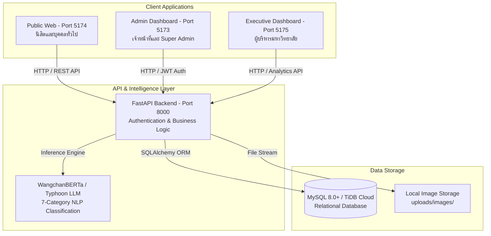

# 📘 คู่มือการติดตั้งและใช้งานระบบ (System Installation & Deployment Manual)
## โครงงาน: University Social Listening & Problem Reporting Platform (UP Voice)
### ระบบรับฟังเสียงและบริหารจัดการเรื่องร้องเรียนอัจฉริยะ มหาวิทยาลัยพะเยา

---

## 📑 สารบัญ (Table of Contents)
1. [บทนำและสถาปัตยกรรมระบบ (System Overview)](#1-บทนำและสถาปัตยกรรมระบบ)
2. [ความต้องการขั้นต่ำของระบบ (System Requirements)](#2-ความต้องการขั้นต่ำของระบบ)
3. [โครงสร้าง Source Code ของโครงการ (Project Directory Structure)](#3-โครงสร้าง-source-code-ของโครงการ)
4. [วิธีติดตั้งแบบด่วน One-Click (Quick Start - Recommended)](#4-วิธีติดตั้งแบบด่วน-one-click-recommended)
5. [วิธีติดตั้งแบบละเอียดทีละขั้นตอน (Step-by-Step Manual Setup)](#5-วิธีติดตั้งแบบละเอียดทีละขั้นตอน)
   - [5.1 การติดตั้งและเตรียมฐานข้อมูล (Database Setup)](#51-การติดตั้งและเตรียมฐานข้อมูล)
   - [5.2 การติดตั้งและรัน Backend API (FastAPI)](#52-การติดตั้งและรัน-backend-api)
   - [5.3 การตั้งค่าโมเดล AI จำแนกหมวดหมู่ (WangchanBERTa)](#53-การตั้งค่าโมเดล-ai-จำแนกหมวดหมู่)
   - [5.4 การติดตั้งและรัน Public Web (หน้าเว็บสำหรับนิสิต)](#54-การติดตั้งและรัน-public-web)
   - [5.5 การติดตั้งและรัน Admin Dashboard (สำหรับเจ้าหน้าที่)](#55-การติดตั้งและรัน-admin-dashboard)
   - [5.6 การติดตั้งและรัน Executive Dashboard (สำหรับผู้บริหาร)](#56-การติดตั้งและรัน-executive-dashboard)
6. [บัญชีผู้ใช้งานเริ่มต้นสำหรับทดสอบ (Default Test Accounts)](#6-บัญชีผู้ใช้งานเริ่มต้นสำหรับทดสอบ)
7. [การทดสอบความถูกต้องของระบบ (System Verification Checklist)](#7-การทดสอบความถูกต้องของระบบ)
8. [ปัญหาที่พบบ่อยและวิธีแก้ไข (Troubleshooting & FAQs)](#8-ปัญหาที่พบบ่อยและวิธีแก้ไข)
9. [การเตรียม Source Code และแปลงเอกสารส่งอาจารย์ (Packaging for Submission)](#9-การเตรียม-source-code-และแปลงเอกสารส่งอาจารย์)

---

## 1. บทนำและสถาปัตยกรรมระบบ

ระบบ **UP Voice** เป็นแพลตฟอร์มรับฟังเสียงและรวบรวมเรื่องร้องเรียน ปัญหาโครงสร้างพื้นฐาน การเรียนการสอน และการจราจรภายในมหาวิทยาลัยพะเยา โดยนำเทคโนโลยีประมวลผลภาษาธรรมชาติ (NLP) ด้วยโมเดล **WangchanBERTa** มาช่วยคัดกรองคำหยาบคาย จำแนกหมวดหมู่อัตโนมัติ 7 ด้าน และสกัดพิกัดอาคารสถานที่ 45 แห่ง พร้อมส่งต่อไปยังเจ้าหน้าที่ผู้รับผิดชอบโดยตรง



### ตารางเทคโนโลยีที่ใช้ (Tech Stack)
| เลเยอร์ (Layer) | เทคโนโลยีที่ใช้ | วัตถุประสงค์ |
|---|---|---|
| **Backend API** | Python 3.10+, FastAPI, SQLAlchemy, Pydantic, Uvicorn | จัดการ REST API, ประมวลผลข้อมูล และเชื่อมโยงฐานข้อมูล |
| **Database** | MySQL 8.0+ หรือ TiDB Cloud | จัดเก็บข้อมูลผู้ใช้, เรื่องร้องเรียน, พิกัดสถานที่ และประวัติการทำงาน |
| **AI / NLP** | Fine-tuned WangchanBERTa, Scikit-learn, PyTorch | ตัดคำ, ตรวจคำไม่เหมาะสม, จัดหมวดหมู่ 7 ด้าน และจับคู่พิกัดอัตโนมัติ |
| **Public Web** | React 18, TypeScript, Vite, Tailwind CSS | ระบบแจ้งเรื่อง, ติดตามสถานะ (Tracking) และหน้าฟีดสาธารณะสำหรับนิสิต |
| **Admin Dashboard** | React 18, Vite, Tailwind CSS, Recharts, Leaflet | ระบบบริหารตั๋วงาน, จัดการสิทธิ์, แดชบอร์ดสถิติ และแผนที่ความร้อน (Heatmap) |
| **Executive Dashboard** | React 18, Vite, Tailwind CSS, Recharts | ระบบแสดงผลสรุปตัวชี้วัดเชิงบริหาร (Executive KPIs) |

---

## 2. ความต้องการขั้นต่ำของระบบ

### 2.1 ด้านฮาร์ดแวร์ (Hardware Requirements)
- **หน่วยประมวลผล (CPU)**: 4 Cores ขึ้นไป (แนะนำ Intel Core i5/i7 หรือ AMD Ryzen 5 ขึ้นไป)
- **หน่วยความจำ (RAM)**: 8 GB ขึ้นไป (แนะนำ 16 GB หากรันโมเดล AI เต็มรูปแบบ)
- **พื้นที่จัดเก็บข้อมูล (Storage)**: พื้นที่ว่างอย่างน้อย 5 GB (SSD แนะนำ)

### 2.2 ด้านซอฟต์แวร์ (Software Requirements)
ก่อนเริ่มต้นการติดตั้ง ต้องติดตั้งโปรแกรมพื้นฐานดังต่อไปนี้บนเครื่องคอมพิวเตอร์:
1. **ระบบปฏิบัติการ**: Windows 10/11, macOS, หรือ Ubuntu Linux 20.04+
2. **Python**: เวอร์ชัน **3.10.x** หรือ **3.11.x** ([ดาวน์โหลดที่ python.org](https://www.python.org/downloads/))
   - *ข้อสำคัญ*: ขณะติดตั้งบน Windows ให้ติ๊กถูกหน้าช่อง **"Add Python to PATH"** เสมอ
3. **Node.js & npm**: เวอร์ชัน **18.x LTS** หรือ **20.x LTS** ([ดาวน์โหลดที่ nodejs.org](https://nodejs.org/))
4. **Database Server**: **MySQL Server 8.0+** ([ดาวน์โหลด MySQL Community Server](https://dev.mysql.com/downloads/mysql/)) พร้อม **MySQL Workbench** หรือใช้บัญชีฐานข้อมูล **TiDB Cloud Free Tier**
5. **Git**: เวอร์ชันล่าสุด ([ดาวน์โหลดที่ git-scm.com](https://git-scm.com/))

---

## 3. โครงสร้าง Source Code ของโครงการ

```text
app-min/
├── backend/
│   └── university_social_listening/      # โฟลเดอร์ระบบ Backend (FastAPI)
│       ├── app/
│       │   ├── main.py                   # จุดเริ่มต้นเซิร์ฟเวอร์ FastAPI และตั้งค่า CORS
│       │   ├── database.py               # เชื่อมต่อ Database & SQLAlchemy Engine
│       │   ├── models.py                 # โครงสร้างตารางฐานข้อมูล 26 ตาราง (ORM)
│       │   ├── schemas.py                # Pydantic Schemas ตรวจสอบ Request/Response
│       │   ├── routers/                  # API Endpoints (auth, problems, users, analytics ฯลฯ)
│       │   └── services/                 # บริการ AI, WangchanBERTa, Mailer
│       ├── scripts/                      # สคริปต์จัดการฐานข้อมูลและเทรนโมเดล AI
│       │   └── init_demo_database.py     # สคริปต์เตรียมตารางและบัญชีทดสอบระบบ
│       ├── models/                       # โฟลเดอร์สำหรับจัดเก็บไฟล์โมเดล AI
│       ├── uploads/                      # โฟลเดอร์จัดเก็บรูปภาพหลักฐานที่ผู้ใช้แนบ
│       ├── requirements.txt              # รายการ Python Library ที่ต้องใช้
│       └── .env.example                  # ไฟล์ตัวอย่างการตั้งค่า Environment
├── frontend/
│   ├── up_voice_public_web/              # เว็บไซต์แจ้งปัญหาและติดตามสถานะสำหรับนิสิต (Port 5174)
│   ├── up_voice_admin_dashboard/         # เว็บไซต์สำหรับเจ้าหน้าที่และผู้ดูแลระบบ (Port 5173)
│   └── up_voice_executive_dashboard/     # แดชบอร์ดสรุปผลสำหรับผู้บริหาร (Port 5175)
├── scripts/                              # สคริปต์อำนวยความสะดวกบน Windows
│   ├── setup_project.bat                 # สคริปต์ติดตั้ง Dependencies ทั้งหมด (One-Click)
│   ├── start_all.bat                     # สคริปต์เริ่มรันทั้งระบบพร้อมเปิดเว็บเบราว์เซอร์
│   └── package_source_code.bat           # สคริปต์บีบอัด Source Code สำหรับส่งอาจารย์
├── INSTALLATION_GUIDE.md                 # คู่มือการติดตั้งระบบฉบับนี้
└── README.md                             # ภาพรวมโปรเจกต์
```

---

## 4. วิธีติดตั้งแบบด่วน One-Click (Recommended)

หากใช้งานบนระบบปฏิบัติการ **Windows** สามารถติดตั้งและเปิดระบบได้อย่างง่ายดายผ่านสคริปต์สำเร็จรูปใน 3 ขั้นตอน:

### ขั้นตอนที่ 1: ติดตั้งไลบรารีทั้งหมดในครั้งเดียว
ดับเบิลคลิกไฟล์:
```text
scripts\setup_project.bat
```
*(สคริปต์จะทำการสร้าง `.venv`, ติดตั้ง `pip install`, รัน `npm install` ในทุกเว็บแอป และสร้างไฟล์ `.env` ให้อัตโนมัติ)*

### ขั้นตอนที่ 2: เตรียมฐานข้อมูลและบัญชีทดสอบ
เปิด Terminal หรือ Command Prompt แล้วสั่งรันคำสั่ง:
```powershell
cd backend\university_social_listening
.venv\Scripts\activate
python scripts\init_demo_database.py
```
*(สคริปต์จะสร้างตารางทั้งหมด นำเข้า 7 หมวดหมู่ อาคาร มพ. 45 แห่ง บัญชีทดสอบ และตั๋วตัวอย่าง 5 ใบ)*

### ขั้นตอนที่ 3: เริ่มรันระบบทั้งหมด
ดับเบิลคลิกไฟล์:
```text
scripts\start_all.bat
```
*(ระบบจะเปิดหน้าจอ Terminal แยกของ Backend และ Frontend ทั้งหมด พร้อมเปิดเบราว์เซอร์เข้าหน้าระบบให้อัตโนมัติ)*

---

## 5. วิธีติดตั้งแบบละเอียดทีละขั้นตอน

### 5.1 การติดตั้งและเตรียมฐานข้อมูล

1. เปิดโปรแกรม **MySQL Workbench** แล้วเชื่อมต่อกับ Local MySQL Server
2. เปิดแท็บ Query ใหม่ แล้วรันคำสั่งสร้างฐานข้อมูล:
   ```sql
   CREATE DATABASE university_social_listening 
   CHARACTER SET utf8mb4 
   COLLATE utf8mb4_unicode_ci;
   ```
3. กำหนดสิทธิ์หรือตรวจสอบว่าชื่อผู้ใช้ `root` และรหัสผ่านตรงกับที่คุณตั้งไว้ใน MySQL

---

### 5.2 การติดตั้งและรัน Backend API

1. เปิด **PowerShell** หรือ **Command Prompt** แล้วเข้าไปที่โฟลเดอร์ backend:
   ```powershell
   cd backend\university_social_listening
   ```
2. สร้างและเปิดใช้งาน Python Virtual Environment:
   ```powershell
   python -m venv .venv
   .venv\Scripts\activate
   ```
3. ติดตั้งไลบรารี Python:
   ```powershell
   pip install --upgrade pip
   pip install -r requirements.txt
   ```
4. สร้างไฟล์ `.env` โดยคัดลอกมาจาก `.env.example`:
   ```powershell
   copy .env.example .env
   ```
5. เปิดไฟล์ `.env` แก้ไขรหัสผ่านฐานข้อมูลให้ตรงกับเครื่องของคุณ:
   ```env
   DB_HOST=localhost
   DB_PORT=3306
   DB_USER=root
   DB_PASSWORD=รหัสผ่านMySQLของคุณ
   DB_NAME=university_social_listening
   DB_SSL=false
   SECRET_KEY=dev-secret-key-up-voice-senior-project-2026
   ```
6. รันสคริปต์เตรียมข้อมูลเริ่มต้น:
   ```powershell
   python scripts\init_demo_database.py
   ```
7. รันเซิร์ฟเวอร์ Backend:
   ```powershell
   uvicorn app.main:app --reload --port 8000
   ```
8. **ทดสอบผลลัพธ์**: เปิดเบราว์เซอร์ไปที่ [http://localhost:8000/docs](http://localhost:8000/docs) เพื่อดูหน้า Interactive API Documentation (Swagger UI)

---

### 5.3 การตั้งค่าโมเดล AI จำแนกหมวดหมู่

ระบบ UP Voice รองรับการจำแนกปัญหาด้วยโมเดล 2 ระดับ:
1. **ระดับที่ 1 (Fallback Rule-based & Semantic Classifier)**:
   - ระบบมีระบบวิเคราะห์คีย์เวิร์ดภาษาไทยกว่า 500 คำ พร้อมพิกัดอาคาร 45 แห่งในตัว สามารถทำงานได้ทันทีแม้ไม่ได้โหลดโมเดลขนาดใหญ่ลงเครื่อง
2. **ระดับที่ 2 (Fine-tuned WangchanBERTa Transformer)**:
   - วางโฟลเดอร์โมเดลที่เทรนแล้ว (มีไฟล์ `model.safetensors`, `config.json`, `tokenizer`) ไว้ที่:
     `backend\university_social_listening\models\finetuned_model\`
   - ตรวจสอบในไฟล์ `.env` ว่าค่า `WANGCHAN_MODEL_DIR=./models/finetuned_model` ถูกต้อง

---

### 5.4 การติดตั้งและรัน Public Web (หน้าเว็บสำหรับนิสิต)

หน้าเว็บนี้สำหรับนิสิตและประชาชนทั่วไป ใช้แจ้งปัญหา ติดตามสถานะตั๋ว (Ticket Tracking) และดูฟีด

1. เปิด Terminal ใหม่ แล้วเข้าไปที่โฟลเดอร์:
   ```powershell
   cd frontend\up_voice_public_web
   ```
2. ติดตั้ง Dependencies:
   ```powershell
   npm install
   ```
3. ตรวจสอบไฟล์ `.env` (หากยังไม่มีให้คัดลอก):
   ```powershell
   copy .env.example .env
   ```
   เนื้อหาใน `.env`:
   ```env
   VITE_API_URL=http://localhost:8000/api/v1
   VITE_API_AUTH_URL=http://localhost:8000/api/v1/auth
   ```
4. รัน Development Server:
   ```powershell
   npm run dev
   ```
5. เข้าใช้งานได้ที่: [http://localhost:5174](http://localhost:5174)

---

### 5.5 การติดตั้งและรัน Admin Dashboard (สำหรับเจ้าหน้าที่)

หน้าเว็บนี้สำหรับเจ้าหน้าที่ประจำหมวดหมู่ (Category Admin) และผู้ดูแลระบบสูงสุด (Super Admin) ใช้บริหารจัดการตั๋ว อัปเดตสถานะปัญหา และดูสถิติ

1. เปิด Terminal ใหม่ แล้วเข้าไปที่โฟลเดอร์:
   ```powershell
   cd frontend\up_voice_admin_dashboard
   ```
2. ติดตั้ง Dependencies:
   ```powershell
   npm install
   ```
3. ตรวจสอบไฟล์ `.env`:
   ```powershell
   copy .env.example .env
   ```
   เนื้อหาใน `.env`:
   ```env
   VITE_API_URL=http://localhost:8000/api/v1
   ```
4. รัน Development Server:
   ```powershell
   npm run dev
   ```
5. เข้าใช้งานได้ที่: [http://localhost:5173](http://localhost:5173)

---

### 5.6 การติดตั้งและรัน Executive Dashboard (สำหรับผู้บริหาร)

1. เปิด Terminal ใหม่ แล้วเข้าไปที่โฟลเดอร์:
   ```powershell
   cd frontend\up_voice_executive_dashboard
   ```
2. ติดตั้ง Dependencies และรัน Server:
   ```powershell
   npm install
   npm run dev
   ```
3. เข้าใช้งานได้ที่: [http://localhost:5175](http://localhost:5175)

---

## 6. บัญชีผู้ใช้งานเริ่มต้นสำหรับทดสอบ

ระบบได้จัดเตรียมบัญชีตัวอย่างครอบคลุมทุกระดับสิทธิ์ สำหรับอาจารย์และกรรมการใช้ทดสอบระบบ:

| บทบาท (Role) | อีเมล (Email) | รหัสผ่าน (Password) | สิทธิ์และการเข้าถึง |
|---|---|---|---|
| **Super Admin** | `superadmin@up.ac.th` | `123456` | สิทธิ์สูงสุด: จัดการผู้ใช้, จัดการสิทธิ์แอดมิน, ดู Audit Logs, จัดการทุกปัญหา |
| **Category Admin (อาคาร)** | `admin.facilities@up.ac.th` | `123456` | แอดมินหมวดอาคารและสถานที่: รับเรื่อง, มอบหมายงาน, เปลี่ยนสถานะเป็น RESOLVED |
| **Category Admin (จราจร)** | `admin.traffic@up.ac.th` | `123456` | แอดมินหมวดการเดินทางและขนส่ง (รถเมล์ มพ.): จัดการปัญหาการจราจร |
| **Student (นิสิต)** | `student@up.ac.th` | `123456` | ผู้ใช้ทั่วไป: ล็อกอินแจ้งปัญหา, กด Upvote, คอมเมนต์, ติดตามผล |
| **Staff (บุคลากร)** | `staff@up.ac.th` | `123456` | บุคลากร มพ.: แจ้งเรื่องร้องเรียน, ติดตามปัญหาภายใน |

> [!TIP]
> ทุกบัญชีสามารถเข้าสู่ระบบได้ที่หน้า **Admin Dashboard** (`http://localhost:5173`) หรือ **Public Web** (`http://localhost:5174`)

---

## 7. การทดสอบความถูกต้องของระบบ

เพื่อความมั่นใจก่อนส่งมอบงาน ให้ปฏิบัติตาม **Checklist** การทดสอบดังนี้:

- [ ] **1. Backend Health Check**: เข้าไปที่ `http://localhost:8000/docs` หน้าเว็บโหลดและแสดงรายการ Endpoint ทั้งหมด
- [ ] **2. การแจ้งปัญหาใหม่ (Public Web)**:
  - เข้า `http://localhost:5174`
  - กดแจ้งเรื่อง เช่น *"แอร์ห้อง ICT 1204 ไม่เย็น"*
  - สังเกตว่าระบบแนะนำหมวดหมู่ **"สิ่งอำนวยความสะดวกและอาคารสถานที่"** และพิกัด **"คณะ ICT"** ให้อัตโนมัติ
- [ ] **3. การเข้าสู่ระบบ Super Admin (Admin Dashboard)**:
  - เข้า `http://localhost:5173`
  - ล็อกอินด้วย `superadmin@up.ac.th` / `123456`
  - ตรวจสอบว่าหน้า Dashboard แสดงตัวเลขสถิติ กราฟวงกลม และหมุดบนแผนที่
- [ ] **4. การเปลี่ยนสถานะงาน (Workflow Tracking)**:
  - ไปที่หน้า **จัดการปัญหา (Manage Problems)**
  - เปลี่ยนสถานะจาก `OPEN` -> `IN_PROGRESS` -> `RESOLVED`
  - กลับมาดูที่หน้า Public Web ตรวจสอบว่าสถานะอัปเดตเป็นสีเขียวและมีบันทึกประวัติ

---

## 8. ปัญหาที่พบบ่อยและวิธีแก้ไข

### 8.1 Error: `Can't connect to MySQL server on 'localhost'`
- **สาเหตุ**: บริการ MySQL Server บนเครื่องยังไม่ได้เปิดทำงาน
- **วิธีแก้**: กดปุ่ม Windows พิมพ์ `services.msc` ค้นหาบริการชื่อ `MySQL80` แล้วคลิกขวาเลือก **Start**

### 8.2 Error: `Access denied for user 'root'@'localhost'`
- **สาเหตุ**: รหัสผ่านของ MySQL ในไฟล์ `.env` ไม่ถูกต้อง
- **วิธีแก้**: เปิดไฟล์ `backend\university_social_listening\.env` แก้ไขค่า `DB_PASSWORD=` ให้ตรงกับรหัสผ่านจริงของ MySQL

### 8.3 Error: `Port 5173 / 5174 / 8000 is already in use`
- **สาเหตุ**: มีโปรแกรมอื่นหรือ Terminal เดิมค้างเปิดพอร์ตอยู่
- **วิธีแก้**: ปิดหน้าต่าง Command Prompt เก่าทั้งหมด หรือรันคำสั่งหา Process แล้วสั่ง kill:
  ```powershell
  netstat -ano | findstr :8000
  taskkill /PID <PID_NUMBER> /F
  ```

### 8.4 Error: `Execution of scripts is disabled on this system` (PowerShell)
- **สาเหตุ**: นโยบายความปลอดภัยของ PowerShell บล็อกการรัน activate script
- **วิธีแก้**: เปิด PowerShell แบบ Run as Administrator แล้วพิมพ์คำสั่ง:
  ```powershell
  Set-ExecutionPolicy -Scope CurrentUser RemoteSigned
  ```

---

## 9. การเตรียม Source Code และแปลงเอกสารส่งอาจารย์

### 9.1 การสร้างไฟล์ ZIP Source Code สะอาดสำหรับส่ง
ในการส่งมอบงาน ไม่ควรแนบโฟลเดอร์ขนาดใหญ่ เช่น `node_modules` (หลายร้อย MB) และ `venv` ไปด้วย ให้ทำดังนี้:
1. ดับเบิลคลิกที่ไฟล์:
   ```text
   scripts\package_source_code.bat
   ```
2. ระบบจะคัดลอกเฉพาะ Source Code ที่จำเป็น บีบอัดเป็นไฟล์ `UP_Voice_SourceCode_YYYYMMDD.zip` ขนาดกะทัดรัด พร้อมส่งมอบผ่าน Google Drive, แผ่น CD/DVD หรือ Flash Drive ทันที

### 9.2 วิธีการแปลงคู่มือการติดตั้งนี้เป็นไฟล์ PDF สวยงาม
1. เปิดไฟล์ `INSTALLATION_GUIDE.md` ในโปรแกรม **Visual Studio Code**
2. ติดตั้ง Extension ชื่อ **Markdown PDF** หรือ **Markdown Preview Enhanced**
3. คลิกขวาบนเนื้อหาไฟล์ แล้วเลือก **Markdown PDF: Export (pdf)**
4. จะได้ไฟล์ `INSTALLATION_GUIDE.pdf` ที่จัดหน้าสวยงามพร้อมส่งให้อาจารย์ที่ปรึกษาและกรรมการตรวจโครงงาน
