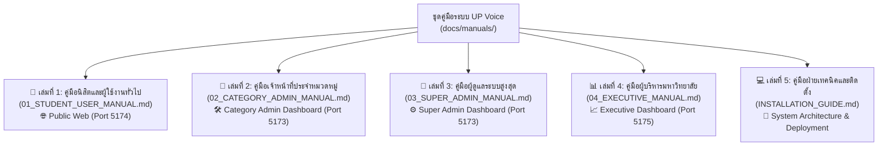

# 📚 ศูนย์รวมคู่มือการใช้งานระบบ UP Voice (UP Voice Manual Suite)
### โครงงาน: University Social Listening & Problem Reporting Platform
**มหาวิทยาลัยพะเยา (University of Phayao)**

---

## 📌 บทนำ (System Overview)
ระบบ **UP Voice** พัฒนาขึ้นเพื่อเป็นช่องทางรับฟังเสียงสะท้อน ข้อเสนอแนะ และการแจ้งปัญหาเชิงรุกภายในมหาวิทยาลัยพะเยา โดยเชื่อมโยงระหว่าง **นิสิต**, **เจ้าหน้าที่ผู้รับผิดชอบงาน**, **ผู้ดูแลระบบ** และ **ผู้บริหารระดับสูง** เข้าด้วยกันผ่านเทคโนโลยี AI อัจฉริยะ (WangchanBERTa NLP) ในการจัดหมวดหมู่และสกัดตำแหน่งสถานที่อัตโนมัติ

เพื่อให้ผู้ใช้งานแต่ละกลุ่มสามารถใช้งานระบบได้อย่างถูกต้องและเต็มประสิทธิภาพ จึงได้จัดทำชุดคู่มือการใช้งานจำแนกตามบทบาทหน้าที่ (Role-Based Manuals) ทั้งหมด 5 เล่ม ดังนี้:

---

## 📑 สารบัญชุดคู่มือแยกตามบทบาท (Manual Directory)

---

## 👥 ตารางเปรียบเทียบบทบาท หน้าที่ และลิงก์เข้าใช้งาน

| เล่ม | บทบาท (Role) | แพลตฟอร์ม / พอร์ต | หน้าที่หลัก | ลิงก์เอกสาร |
|---|---|---|---|---|
| **เล่มที่ 1** | **นิสิต / บุคลากร / บุคคลทั่วไป** (Student / Staff / Public) | **Public Web** `http://localhost:5174` | แจ้งปัญหา, AI แนะนำหมวดหมู่และพิกัด, ติดตามตั๋วด้วย Tracking Code, ส่องฟีดสาธารณะ, กด Upvote และร่วมแสดงความเห็น | [อ่านคู่มือเล่มที่ 1](01_STUDENT_USER_MANUAL.md) |
| **เล่มที่ 2** | **เจ้าหน้าที่ประจำหมวดหมู่** (Category Admin) | **Admin Dashboard** `http://localhost:5173/category-admin` | รับเรื่องร้องเรียน, บริหารสถานะตั๋วบน Kanban Board, อัปเดตการทำงาน (`IN_PROGRESS`), แนบรูป Before/After และปิดงาน (`RESOLVED`) | [อ่านคู่มือเล่มที่ 2](02_CATEGORY_ADMIN_MANUAL.md) |
| **เล่มที่ 3** | **ผู้ดูแลระบบสูงสุด** (Super Admin) | **Admin Dashboard** `http://localhost:5173/super-admin` | วิเคราะห์ Heatmap จุดวิกฤต, จัดการสิทธิ์แอดมิน, จัดการบัญชีผู้ใช้/ระบบ Strike, จัดการ Master Data (45 อาคาร/7 หมวดหมู่), ตั้งค่า AI | [อ่านคู่มือเล่มที่ 3](03_SUPER_ADMIN_MANUAL.md) |
| **เล่มที่ 4** | **ผู้บริหารระดับสูง** (Executive / Director) | **Executive Dashboard** `http://localhost:5175` | ติดตามตัวชี้วัดความสำเร็จ (KPIs), อัตราการแก้ไข (Resolution Rate), เวลาเฉลี่ยในการปิดงาน (MTTR), แนวโน้มปัญหาตามคณะและหมวดหมู่ | [อ่านคู่มือเล่มที่ 4](04_EXECUTIVE_MANUAL.md) |
| **เล่มที่ 5** | **ฝ่ายเทคนิคและผู้ดูแลระบบ** (DevOps / Tech Lead) | **Server & Console** Backend FastAPI, MySQL, Python | การติดตั้งโปรแกรม, การรันระบบ One-Click, การย้ายฐานข้อมูล (Migration), การตั้งค่า `.env` และการดูแลโมเดล WangchanBERTa | [อ่านคู่มือเล่มที่ 5](../../INSTALLATION_GUIDE.md) |

---

## 🔑 บัญชีสำหรับทดสอบระบบ (Default Test Accounts)

| บทบาท | อีเมล (Email) | รหัสผ่าน (Password) | พอร์ตที่เข้าใช้งาน |
|---|---|---|---|
| **Super Admin** | `superadmin@up.ac.th` | `123456` | `http://localhost:5173` |
| **Category Admin (อาคาร)** | `admin.facilities@up.ac.th` | `123456` | `http://localhost:5173` |
| **Category Admin (จราจร)** | `admin.traffic@up.ac.th` | `123456` | `http://localhost:5173` |
| **Student (นิสิต)** | `student@up.ac.th` | `123456` | `http://localhost:5174` |
| **Staff (บุคลากร)** | `staff@up.ac.th` | `123456` | `http://localhost:5174` |
| **Executive (ผู้บริหาร)** | เข้าสู่ระบบผ่านหน้า Executive Login | — | `http://localhost:5175` |

---
*จัดทำโดย: ทีมพัฒนาระบบ UP Voice มหาวิทยาลัยพะเยา*

