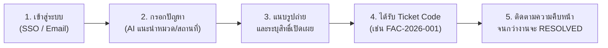
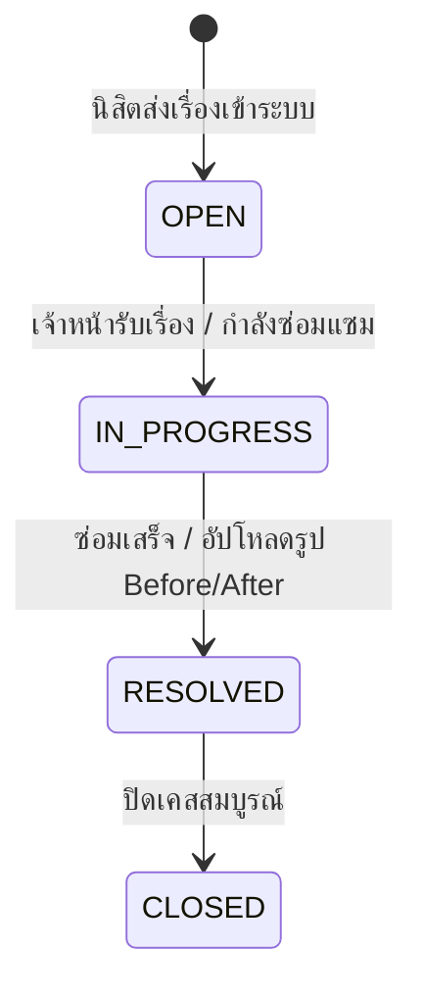

# 📘 คู่มือการใช้งานระบบสำหรับนิสิตและผู้ใช้งานทั่วไป (Student & Public User Manual)
### แพลตฟอร์ม: UP Voice Public Web
**URL สำหรับเข้าใช้งาน**: `http://localhost:5174`

---

## 📑 สารบัญ (Table of Contents)
1. [บทนำและภาพรวมการใช้งาน](#1-บทนำและภาพรวมการใช้งาน)
2. [การเข้าสู่ระบบและการลงทะเบียน (Login & Registration)](#2-การเข้าสู่ระบบและการลงทะเบียน)
3. [ขั้นตอนการแจ้งเรื่องร้องเรียน/ปัญหาใหม่ (Submitting a Report)](#3-ขั้นตอนการแจ้งเรื่องร้องเรียนปัญหาใหม่)
   - [3.1 การกรอกข้อมูลและการทำงานของ AI อัจฉริยะ](#31-การกรอกข้อมูลและการทำงานของ-ai-อัจฉริยะ)
   - [3.2 การอัปโหลดรูปภาพและการปักหมุดแผนที่](#32-การอัปโหลดรูปภาพและการปักหมุดแผนที่)
   - [3.3 การเลือกระดับความเป็นส่วนตัว (Visibility Settings)](#33-การเลือกระดับความเป็นส่วนตัว)
4. [การติดตามสถานะเรื่องร้องเรียน (Ticket Tracking)](#4-การติดตามสถานะเรื่องร้องเรียน)
   - [4.1 ตรวจสอบด้วยรหัสตั๋ว (Ticket Code)](#41-ตรวจสอบด้วยรหัสตั๋ว-ticket-code)
   - [4.2 ความหมายของสถานะการดำเนินงาน (Status Lifecycle)](#42-ความหมายของสถานะการดำเนินงาน)
   - [4.3 การดูผลการแก้ไขและภาพหลักฐาน Before / After](#43-การดูผลการแก้ไขและภาพหลักฐาน-before--after)
5. [การมีส่วนร่วมในกระดานสาธารณะ (Explore & Community Interaction)](#5-การมีส่วนร่วมในกระดานสาธารณะ)
   - [5.1 การค้นหาและกรองปัญหา](#51-การค้นหาและกรองปัญหา)
   - [5.2 การกดโหวตเห็นด้วย (Upvote) และการแสดงความคิดเห็น](#52-การกดโหวตเห็นด้วย-upvote-และการแสดงความคิดเห็น)
6. [กฎระเบียบชุมชนและระบบความปลอดภัย (Community Rules & Strike Policy)](#6-กฎระเบียบชุมชนและระบบความปลอดภัย)

---

## 1. บทนำและภาพรวมการใช้งาน

ระบบ **UP Voice Public Web** ออกแบบมาเพื่อให้นิสิต บุคลากร และบุคคลทั่วไป สามารถแจ้งปัญหาโครงสร้างพื้นฐาน การเรียนการสอน การจราจร หรือความปลอดภัยในมหาวิทยาลัยพะเยาได้อย่างสะดวกรวดเร็ว โดยมีเทคโนโลยี AI คอยช่วยเหลือจัดหมวดหมู่และส่งเรื่องไปยังเจ้าหน้าที่ผู้รับผิดชอบโดยตรง

---

## 2. การเข้าสู่ระบบและการลงทะเบียน

เมื่อเข้าสู่ระบบที่ `http://localhost:5174` ระบบจะแสดงหน้าจอเข้าสู่ระบบ:

1. **เข้าใช้งานด้วยบัญชีมหาวิทยาลัยพะเยา (UP SSO - แนะนำ)**:
   - กดปุ่ม **"เข้าสู่ระบบด้วย UP Mail / SSO"**
   - ใช้อีเมลมหาวิทยาลัย เช่น `@up.ac.th`
2. **เข้าใช้งานด้วยอีเมลทั่วไป (Email & Password)**:
   - กรอกอีเมลและรหัสผ่าน จากนั้นกด **"เข้าสู่ระบบ"**
   - *บัญชีทดสอบเริ่มต้น*: `student@up.ac.th` / รหัสผ่าน: `123456`
3. **การลงทะเบียนผู้ใช้ใหม่ (สำหรับบุคคลทั่วไป/นิสิตใหม่)**:
   - กดลิงก์ **"สมัครสมาชิกใหม่ (Register)"**
   - กรอกชื่อ-นามสกุล, รหัสนิสิต (ถ้ามี), อีเมล และกำหนดรหัสผ่าน
   - กดยอมรับเงื่อนไขนโยบายคุ้มครองข้อมูลส่วนบุคคล (PDPA Consent)

---

## 3. ขั้นตอนการแจ้งเรื่องร้องเรียน/ปัญหาใหม่

กดเมนู **"แจ้งปัญหาใหม่ (Report Issue)"** หรือไอคอนเครื่องหมายบวก `+` ที่แถบนำทาง

### 3.1 การกรอกข้อมูลและการทำงานของ AI อัจฉริยะ
1. **หัวข้อเรื่อง (Title)**: ระบุสรุปปัญหาแบบกระชับ เช่น *"แอร์ห้อง ICT 1204 ไม่เย็นและมีน้ำหยด"*
2. **รายละเอียด (Description)**: อธิบายลักษณะปัญหาให้ชัดเจน
3. **ระบบ AI ช่วยเหลืออัตโนมัติ (WangchanBERTa NLP)**:
   - **ระบบคัดกรองคำหยาบคาย (Profanity Filter)**: หากตรวจพบข้อความไม่สุภาพ ระบบจะแจ้งเตือนให้แก้ไขก่อนส่ง
   - **ระบบทำนายหมวดหมู่อัตโนมัติ (Smart Categorization)**: AI จะวิเคราะห์เนื้อหาและเลือก 1 ใน 7 หมวดหมู่อัตโนมัติ:
     - 🏢 *สิ่งอำนวยความสะดวกและอาคารสถานที่ (FAC)*
     - 🚌 *การเดินทางและระบบขนส่ง (TRF)*
     - 🚨 *ความปลอดภัยและจราจร (SAF)*
     - 🧹 *ภูมิทัศน์และความสะอาด (CLN)*
     - 📚 *การเรียนการสอนและวิชาการ (EDU)*
     - 📶 *ระบบเครือข่ายและเทคโนโลยี (NET)*
     - 📦 *บริการทั่วไป / อื่นๆ (OTH)*
   - **ระบบสกัดสถานที่อัตโนมัติ (Location Extraction)**: เมื่อมีการพิมพ์ชื่อตึก เช่น *"ห้องสมุด"*, *"คณะ ICT"*, *"หอพักลานไทร"* ระบบจะเลือกอาคารและใส่พิกัด GPS อัตโนมัติ (ผู้แจ้งสามารถกดเปลี่ยนเองได้)

### 3.2 การอัปโหลดรูปภาพและการปักหมุดแผนที่
* **แนบรูปภาพหลักฐาน**: รองรับไฟล์ภาพ `.jpg`, `.png` สูงสุด 5 รูป ขนาดไม่เกิน 5MB ต่อรูป (ภาพถ่ายที่ชัดเจนจะช่วยให้เจ้าหน้าที่ทำงานได้เร็วขึ้น)
* **การระบุพิกัด**: ระบบจะแสดงแผนที่มหาวิทยาลัยพะเยา สามารถคลิกเพื่อเลื่อนหมุดไปยังจุดที่เกิดเหตุจริงได้

### 3.3 การเลือกระดับความเป็นส่วนตัว (Visibility Settings)
ก่อนกดส่งเรื่อง ผู้ใช้สามารถเลือกรูปแบบการเปิดเผยข้อมูลได้ 3 ระดับ:
* 🌐 **สาธารณะ (Public)**: เรื่องร้องเรียนจะปรากฏบนหน้าฟีดสาธารณะ ให้นิสิตคนอื่นสามารถกด Upvote หรือช่วยคอมเมนต์ได้
* 🔒 **เฉพาะเจ้าหน้าที่ (Internal Only)**: ซ่อนเรื่องจากหน้าฟีด มีเพียงเจ้าหน้าที่ผู้รับผิดชอบและผู้บริหารเท่านั้นที่มองเห็น
* 👤 **ไม่ระบุตัวตน (Anonymous)**: เรื่องจะแสดงบนฟีดสาธารณะ แต่ระบบจะปิดบังชื่อและรหัสนิสิตของผู้แจ้งเป็น "ผู้ใช้นิรนาม"

> [!TIP]
> เมื่อกรอกข้อมูลครบถ้วนแล้ว ให้กดปุ่ม **"ส่งเรื่องร้องเรียน (Submit)"** ระบบจะสร้างตั๋วงานและแสดง **รหัสตั๋ว (Ticket Code)** ทันที เช่น `FAC-2026-0042`

---

## 4. การติดตามสถานะเรื่องร้องเรียน (Ticket Tracking)

### 4.1 ตรวจสอบด้วยรหัสตั๋ว (Ticket Code)
* ไปที่เมนู **"ติดตามสถานะ (Tracking)"**
* พิมพ์รหัสตั๋ว เช่น `FAC-2026-0042` ในช่องค้นหา
* หรือไปที่แท็บ **"เรื่องของฉัน (My Reports)"** เพื่อดูประวัติเรื่องทั้งหมดที่ตนเองเคยแจ้งไว้

### 4.2 ความหมายของสถานะการดำเนินงาน (Status Lifecycle)

| ป้ายสถานะ | สี | ความหมายและสิ่งที่เกิดขึ้น |
|---|---|---|
| **OPEN (รับเรื่องแล้ว)** | 🟡 สีส้ม | เรื่องถูกส่งเข้าสู่ระบบแล้ว กำลังรอเจ้าหน้าที่ประจำหมวดหมู่เปิดตรวจและมอบหมายทีมช่าง |
| **IN_PROGRESS (กำลังดำเนินการ)** | 🔵 สีน้ำเงิน | เจ้าหน้าที่รับงานแล้ว ทีมช่างกำลังลงพื้นที่ตรวจสอบหรืออยู่ระหว่างการจัดซื้ออะไหล่ |
| **RESOLVED (แก้ไขเสร็จสิ้น)** | 🟢 สีเขียว | การแก้ไขปัญหาเสร็จเรียบร้อย เจ้าหน้าที่ได้ลงบันทึกผลงานและแนบภาพถ่ายหลังแก้ไข |
| **CLOSED (ปิดเรื่องสมบูรณ์)** | ⚪ สีเทา | เรื่องได้รับการตรวจสอบและปิดเคสเรียบร้อยแล้ว |

### 4.3 การดูผลการแก้ไขและภาพหลักฐาน Before / After
เมื่อสถานะเปลี่ยนเป็น **RESOLVED** หน้ารายละเอียดตั๋วจะแสดง:
* **ข้อความบันทึกจากเจ้าหน้าที่ (Resolution Note)**: เช่น *"ช่างได้ทำการเปลี่ยนมอเตอร์พัดลมแอร์และล้างแผ่นกรองอากาศเรียบร้อยแล้ว"*
* **ภาพถ่ายเปรียบเทียบ Before vs. After**: ผู้แจ้งสามารถกดซูมดูภาพก่อนและหลังการซ่อมแซมเพื่อตรวจสอบความเรียบร้อยได้

---

## 5. การมีส่วนร่วมในกระดานสาธารณะ (Community Interaction)

### 5.1 การค้นหาและกรองปัญหา (Explore Feed)
* หน้าหลัก (Home Feed) จะแสดงปัญหาต่างๆ ที่ผู้ใช้อื่นแจ้งเข้ามาในรูปแบบสาธารณะ
* สามารถกรองดูตาม **หมวดหมู่** (เช่น ดูเฉพาะปัญหาถนน/การเดินทาง), ตาม **คณะ**, หรือตาม **สถานะ** (เช่น ดูเฉพาะเรื่องที่กำลังดำเนินการ)

### 5.2 การกดโหวตเห็นด้วย (Upvote) และการแสดงความคิดเห็น
* **ปุ่ม Upvote (▲)**: หากคุณพบเจอปัญหาเดียวกัน (เช่น ไฟทางเดินดับ หรือห้องน้ำเสีย) สามารถกด Upvote เพื่อเพิ่มน้ำหนักความสำคัญ เรื่องที่มีคะแนนโหวตสูงจะถูกดันขึ้นสู่อันดับต้นๆ ของแดชบอร์ดเจ้าหน้าที่
* **การคอมเมนต์ (Comments)**: สามารถพิมพ์แจ้งข้อมูลเพิ่มเติม เช่น *"วันนี้เวลา 14:00 น. ยังพบปัญหาน้ำหยดอยู่ครับ"* เพื่อเป็นประโยชน์ต่อทีมช่าง

---

## 6. กฎระเบียบชุมชนและระบบความปลอดภัย (Community Rules & Strike Policy)

เพื่อให้พื้นที่ UP Voice เป็นสังคมที่ปลอดภัยและสร้างสรรค์ ระบบมีกลไกตรวจสอบและบทลงโทษดังนี้:

> [!WARNING]
> **ระบบตัดแต้มความประพฤติ (Strike Count System)**
> * ห้ามโพสต์ข้อความหยาบคาย รังแก คุกคาม หรือเสียดสีผู้อื่น
> * ห้ามแจ้งข้อมูลเท็จหรือสร้างเรื่องรบกวนการทำงานของเจ้าหน้าที่
> * **หากทำผิดกฎ 1 ครั้ง**: ได้รับการตักเตือน (1 Strike)
> * **หากสะสมครบ 3 Strikes**: ระบบจะ **ระงับการใช้งานบัญชี (Ban)** โดยอัตโนมัติ และไม่สามารถแจ้งเรื่องได้อีกจนกว่าผู้ดูแลระบบส่วนกลางจะปลดแบน

---
*หากพบปัญหาการใช้งานเว็บไซต์ ติดต่อฝ่ายสนับสนุน: `support-voice@up.ac.th`*

