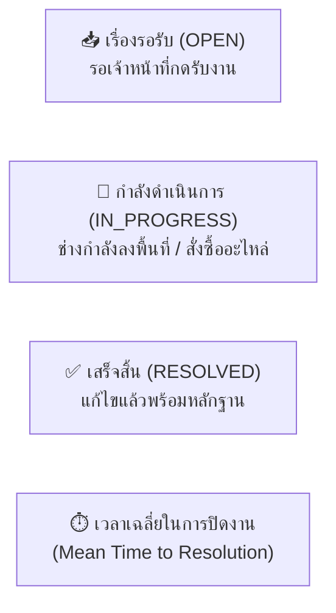

# 📙 คู่มือการใช้งานระบบสำหรับเจ้าหน้าที่ประจำหมวดหมู่ (Category Admin Manual)
### แพลตฟอร์ม: UP Voice Admin Dashboard (หมวดหมู่งาน)
**URL สำหรับเข้าใช้งาน**: `http://localhost:5173/category-admin`

---

## 📑 สารบัญ (Table of Contents)
1. [บทนำและบทบาทหน้าที่ของ Category Admin](#1-บทนำและบทบาทหน้าที่ของ-category-admin)
2. [การเข้าสู่ระบบและการตั้งค่าโปรไฟล์ (Login & Profile Setup)](#2-การเข้าสู่ระบบและการตั้งค่าโปรไฟล์)
3. [แดชบอร์ดภาพรวมประจำหมวดหมู่ (Category Dashboard Overview)](#3-แดชบอร์ดภาพรวมประจำหมวดหมู่)
4. [การบริหารจัดการตั๋วงานผ่านกระดาน Kanban (Kanban Board Workflow)](#4-การบริหารจัดการตั๋วงานผ่านกระดาน-kanban)
   - [4.1 การคัดกรองและเปิดดูรายละเอียดตั๋ว (Ticket Inspection)](#41-การคัดกรองและเปิดดูรายละเอียดตั๋ว)
   - [4.2 การรับเรื่องและเปลี่ยนสถานะเป็น IN_PROGRESS](#42-การรับเรื่องและเปลี่ยนสถานะเป็น-in_progress)
   - [4.3 การส่งต่อเรื่องข้ามหมวดหมู่ (Ticket Re-routing)](#43-การส่งต่อเรื่องข้ามหมวดหมู่)
5. [การปิดงานและบันทึกผลการแก้ไข (Resolving & Closing Tickets)](#5-การปิดงานและบันทึกผลการแก้ไข)
   - [5.1 การบันทึกสรุปผลงาน (Resolution Note)](#51-การบันทึกสรุปผลงาน-resolution-note)
   - [5.2 การแนบภาพหลักฐานหลังดำเนินการ (Proof of Work)](#52-การแนบภาพหลักฐานหลังดำเนินการ-proof-of-work)
6. [การตรวจสอบประวัติงานย้อนหลัง (Resolved History)](#6-การตรวจสอบประวัติงานย้อนหลัง)
7. [ข้อควรปฏิบัติและ SLA ในการแก้ไขปัญหา](#7-ข้อควรปฏิบัติและ-sla-ในการแก้ไขปัญหา)

---

## 1. บทนำและบทบาทหน้าที่ของ Category Admin

**Category Admin** คือเจ้าหน้าที่ผู้รับผิดชอบงานประจำหน่วยงาน เช่น กองอาคารสถานที่, งานจราจรและยานพาหนะ, งานภูมิทัศน์และรักษาความสะอาด หรือศูนย์บริการเทคโนโลยีสารสนเทศ (CITCOMS) 

### ขอบเขตอำนาจหน้าที่:
* รับผิดชอบตั๋วงานเฉพาะในหมวดหมู่ที่ตนเองได้รับมอบหมาย
* ตรวจสอบความถูกต้องของปัญหา พิกัดอาคารสถานที่ และระดับความเร่งด่วน
* อัปเดตสถานะการทำงานให้ผู้แจ้งเรื่องรับทราบความคืบหน้าแบบ Real-time
* บันทึกผลการแก้ไขและแนบรูปถ่ายหลักฐานยืนยันความเรียบร้อย

---

## 2. การเข้าสู่ระบบและการตั้งค่าโปรไฟล์

1. เข้าเบราว์เซอร์ไปที่: `http://localhost:5173`
2. กรอกอีเมลและรหัสผ่านของเจ้าหน้าที่:
   * *ตัวอย่างบัญชีทดสอบฝ่ายอาคาร*: `admin.facilities@up.ac.th` / `123456`
   * *ตัวอย่างบัญชีทดสอบฝ่ายจราจร*: `admin.traffic@up.ac.th` / `123456`
3. ระบบจะตรวจสอบสิทธิ์และนำทางเข้าสู่หน้า **Category Admin Portal** (`/category-admin`) โดยอัตโนมัติ
4. **การตั้งค่าโปรไฟล์ (Profile Settings)**:
   - ไปที่เมนู **"โปรไฟล์และการตั้งค่า (Settings)"**
   - ตรวจสอบชื่อ-นามสกุล, ตำแหน่ง, ฝ่าย/กองงาน และเบอร์โทรศัพท์ติดต่อภายใน

---

## 3. แดชบอร์ดภาพรวมประจำหมวดหมู่ (Category Dashboard Overview)

หน้าแรกของ Category Admin จะแสดงสถิติและตัวชี้วัดสำคัญของหมวดหมู่งานตนเอง:



* **แถบตัวชี้วัด (KPI Cards)**: แสดงจำนวนตั๋วสะสมในแต่ละสถานะ
* **ตั๋วความสำคัญสูง (Urgent / High-Upvote Tickets)**: รายการปัญหาที่มีการกดโหวตจากนิสิตสูงสุด เพื่อให้เจ้าหน้าที่จัดลำดับความสำคัญก่อน
* **แผนที่พิกัดปัญหา (Location Pinpoint)**: แสดงจุดเกิดเหตุในหมวดหมู่ตนเองบนแผนผังมหาวิทยาลัย

---

## 4. การบริหารจัดการตั๋วงานผ่านกระดาน Kanban (Kanban Board Workflow)

คลิกที่เมนู **"กระดานงาน (Kanban Board)"** เพื่อจัดการตั๋วงานด้วยรูปแบบลากและวาง (Drag & Drop) หรือคลิกเปลี่ยนสถานะ:

```text
+-------------------+   +-----------------------+   +--------------------+
|    OPEN (รับเรื่อง)  | ➜ | IN_PROGRESS (กำลังทำ) | ➜ | RESOLVED (เสร็จสิ้น) |
|-------------------|   |-----------------------|   |--------------------|
| [FAC-001] แอร์รั่ว   |   | [FAC-003] เปลี่ยนหลอดไฟ |   | [FAC-002] ซ่อมประตู |
| [FAC-004] ลิฟต์ค้าง |   |                       |   |                    |
+-------------------+   +-----------------------+   +--------------------+
```

### 4.1 การคัดกรองและเปิดดูรายละเอียดตั๋ว (Ticket Inspection)
* คลิกที่การ์ดตั๋วเพื่อเปิดหน้าต่าง **Ticket Detail Modal**
* ตรวจสอบข้อมูล:
  - **รายละเอียดปัญหา**: ข้อความที่ผู้แจ้งระบุ
  - **สถานที่และพิกัด GPS**: อาคาร ชั้น หรือบริเวณที่เกิดเหตุ
  - **ภาพถ่ายหลักฐาน (Before Image)**: รูปภาพที่ผู้แจ้งแนบมา
  - **จำนวน Upvote และคอมเมนต์**: สังเกตผลกระทบต่อส่วนรวม

### 4.2 การรับเรื่องและเปลี่ยนสถานะเป็น IN_PROGRESS
* เมื่อเจ้าหน้าที่ได้มอบหมายช่างหรือลงพื้นที่ ให้เลื่อนสถานะเป็น **"IN_PROGRESS (กำลังดำเนินการ)"**
* ผู้แจ้งเรื่องจะได้รับการแจ้งเตือนทันทีว่ามีเจ้าหน้าที่กำลังจัดการปัญหาอยู่

### 4.3 การส่งต่อเรื่องข้ามหมวดหมู่ (Ticket Re-routing)
* หากพบว่าปัญหาไม่ได้อยู่ในอำนาจหน้าที่ของหมวดตนเอง (เช่น แจ้งหมวดอาคารแต่เป็นปัญหาสัญญาณ WiFi ล่ม)
* ให้กดปุ่ม **"ส่งต่อหมวดหมู่ (Re-route Category)"**
* เลือกหมวดหมู่ที่ถูกต้อง (เช่น *ระบบเครือข่ายและเทคโนโลยี*) และระบุเหตุผล ระบบจะโอนตั๋วไปให้เจ้าหน้าที่หมวดนั้นดูแลต่อไป

---

## 5. การปิดงานและบันทึกผลการแก้ไข (Resolving & Closing Tickets)

เมื่อทีมช่างได้ลงพื้นที่และทำการซ่อมแซมปัญหาเรียบร้อยแล้ว:

### 5.1 การบันทึกสรุปผลงาน (Resolution Note)
1. เปิดตั๋วที่ต้องการปิดงาน แล้วกดปุ่ม **"บันทึกการแก้ไข (Resolve Ticket)"**
2. กรอกข้อความสรุปการดำเนินงาน เช่น:
   > *"ทีมช่างได้เข้าตรวจสอบพบท่อน้ำทิ้งแอร์อุดตัน ได้ทำการเป่าล้างทำความสะอาดและเติมน้ำยาแอร์เสร็จเรียบร้อย เปิดทดสอบอุณหภูมิปกติ 24 องศาเซลเซียส"*

### 5.2 การแนบภาพหลักฐานหลังดำเนินการ (Proof of Work)
1. อัปโหลดภาพถ่ายหลังการซ่อมแซมเสร็จสิ้น (**After Image**)
2. ระบบจะจัดเก็บภาพคู่กับภาพก่อนซ่อม (Before & After Comparison)
3. กดปุ่ม **"ยืนยันการแก้ไข (Confirm Resolved)"**
4. สถานะของตั๋วจะเปลี่ยนเป็น `RESOLVED` (สีเขียว) และแจ้งเตือนให้นิสิตผู้แจ้งทราบทันที

---

## 6. การตรวจสอบประวัติงานย้อนหลัง (Resolved History)

* ไปที่เมนู **"ประวัติงานที่เสร็จสิ้น (Resolved History)"**
* สามารถค้นหาตั๋วย้อนหลังด้วย Ticket ID หรือชื่ออาคาร
* กรองตามช่วงวันที่ เพื่อใช้ทำรายงานสรุปผลงานประจำเดือน หรือใช้เป็นฐานข้อมูลในการซ่อมบำรุงซ้ำ (Recurring Maintenance)

---

## 7. ข้อควรปฏิบัติและ SLA ในการแก้ไขปัญหา

> [!IMPORTANT]
> **กรอบเวลามาตรฐานการให้บริการ (Service Level Agreement - SLA)**
> 1. **การรับเรื่อง (OPEN ➜ IN_PROGRESS)**: เจ้าหน้าที่ควรกดรับงานภายใน **24 ชั่วโมง** ของวันทำการ
> 2. **ปัญหาวิกฤตความปลอดภัย (Safety)**: เช่น สัตว์มีพิษ, เสาไฟชำรุด, ทางเดินอันตราย ต้องเข้าตรวจสอบภายใน **4 ชั่วโมง**
> 3. **ภาพหลักฐานปิดงาน**: ต้องเป็นภาพถ่ายพื้นที่จริงที่ชัดเจนและสะท้อนผลการแก้ไขเพื่อความโปร่งใสและสร้างความเชื่อมั่นให้กับนิสิต

---
*หากพบปัญหาด้านสิทธิ์การเข้าถึงหมวดหมู่งาน ติดต่อ Super Admin: `superadmin@up.ac.th`*

