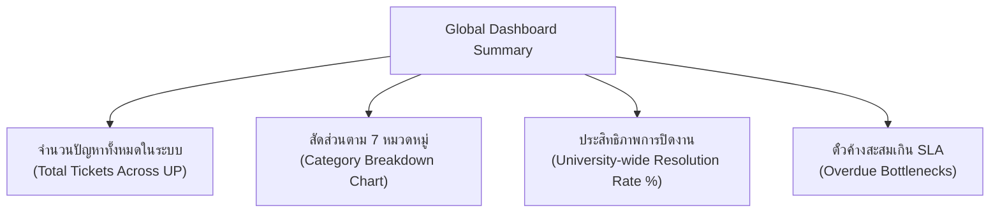
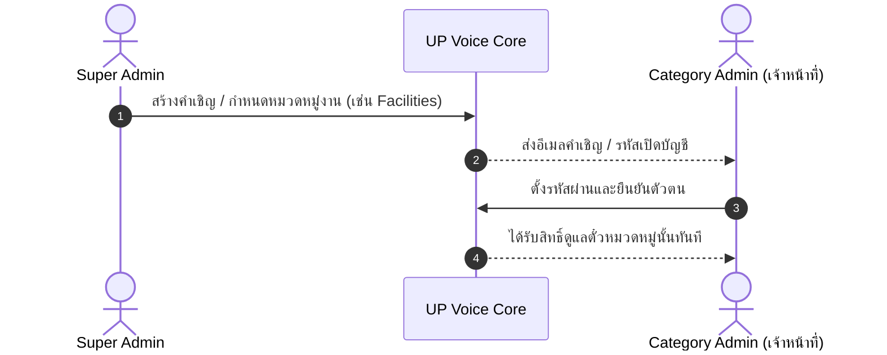

# 📕 คู่มือการใช้งานระบบสำหรับผู้ดูแลระบบสูงสุด (Super Admin Manual)
### แพลตฟอร์ม: UP Voice Super Admin Dashboard
**URL สำหรับเข้าใช้งาน**: `http://localhost:5173/super-admin`

---

## 📑 สารบัญ (Table of Contents)
1. [บทนำและอำนาจหน้าที่ของ Super Admin](#1-บทนำและอำนาจหน้าที่ของ-super-admin)
2. [แดชบอร์ดภาพรวมมหาวิทยาลัย (Global Dashboard)](#2-แดชบอร์ดภาพรวมมหาวิทยาลัย)
3. [การวิเคราะห์เชิงพื้นที่และแผนที่ความร้อน (Global Heatmap Analytics)](#3-การวิเคราะห์เชิงพื้นที่และแผนที่ความร้อน)
4. [การจัดการบัญชีผู้ใช้และระบบลงโทษ (User Management & Strike Policy)](#4-การจัดการบัญชีผู้ใช้และระบบลงโทษ)
5. [การจัดการทีมงานและเชิญเจ้าหน้าที่หมวดหมู่ (Category Admin Management)](#5-การจัดการทีมงานและเชิญเจ้าหน้าที่หมวดหมู่)
6. [การจัดการข้อมูลหลักของระบบ (Master Data Management)](#6-การจัดการข้อมูลหลักของระบบ)
   - [6.1 การจัดการ 7 หมวดหมู่หลัก (Category Management)](#61-การจัดการ-7-หมวดหมู่หลัก)
   - [6.2 การจัดการ 45 อาคารและพิกัดแผนที่ (Building & GPS Management)](#62-การจัดการ-45-อาคารและพิกัดแผนที่)
7. [การควบคุมและปรับแต่งโมเดล AI (LLM Settings & Routing History)](#7-การควบคุมและปรับแต่งโมเดล-ai)
8. [ความปลอดภัยและบันทึกประวัติระบบ (Audit Logs & Security Monitoring)](#8-ความปลอดภัยและบันทึกประวัติระบบ)

---

## 1. บทนำและอำนาจหน้าที่ของ Super Admin

**Super Admin** ถือครองสิทธิ์ระดับสูงสุด (Role 4: `super_admin`) ในระบบ UP Voice มีหน้าที่กำกับดูแลการทำงานของทั้งระบบ จัดการโครงสร้างข้อมูลพื้นฐาน (Master Data) กำกับดูแลเจ้าหน้าที่ทุกหมวดหมู่ และควบคุมการทำงานของโมเดล AI วิเคราะห์ข้อความ

* **บัญชีทดสอบเริ่มต้น**: `superadmin@up.ac.th` / รหัสผ่าน: `123456`
* **การป้องกันสิทธิ์ (Role 4 Guard)**: ระบบมีระบบตรวจสอบ JWT Token อย่างเข้มงวด หากไม่มีสิทธิ์จะไม่สามารถเข้าถึง URL `/super-admin/*` ได้

---

## 2. แดชบอร์ดภาพรวมมหาวิทยาลัย (Global Dashboard)

เมื่อเข้าสู่ระบบ Super Admin จะพบกับหน้า **Global Dashboard** ซึ่งรวมข้อมูลสถิติของทุกหน่วยงานในมหาวิทยาลัยพะเยา:

* **สถิติรายหมวดหมู่**: แสดงเปรียบเทียบว่าหมวดใดมีเรื่องร้องเรียนมากที่สุด (เช่น หมวดอาคาร หรือ หมวดจราจร)
* **การกรองช่วงเวลา**: สามารถเลือกดูสถิติรายวัน, สัปดาห์, เดือน หรือรายภาคการศึกษา

---

## 3. การวิเคราะห์เชิงพื้นที่และแผนที่ความร้อน (Global Heatmap Analytics)

ไปที่เมนู **"แผนที่ความร้อนมหาวิทยาลัย (Global Heatmap)"**

* **แผนผังความหนาแน่นปัญหา**: แผนที่ดาวเทียมของมหาวิทยาลัยพะเยาแสดงกลุ่มความร้อน (Heatmap Clusters) บริเวณที่เกิดเหตุบ่อย
  - 🔴 **สีแดงเข้ม**: จุดวิกฤตที่มีการแจ้งปัญหาซ้ำซ้อนหนาแน่น
  - 🟡 **สีเหลือง/ส้ม**: จุดที่มีความถี่ปานกลาง
  - 🟢 **สีเขียว/ฟ้า**: จุดที่มีการแก้ไขเรียบร้อยแล้ว
* **การกรองเลเยอร์ (Layer Filter)**:
  - กรองดูเฉพาะปัญหาเรื่อง "ไฟฟ้าส่องสว่างดับ" ในช่วงเวลากลางคืน เพื่อประเมินความปลอดภัย
  - กรองดูเฉพาะเส้นทาง "รถเมล์ มพ." เพื่อวางแผนการเดินรถ

---

## 4. การจัดการบัญชีผู้ใช้และระบบลงโทษ (User Management & Strike Policy)

ไปที่เมนู **"จัดการผู้ใช้งาน (User Management)"**

### รายละเอียดการกำกับดูแล:
1. **ค้นหาและตรวจสอบบัญชี**: สามารถค้นหาด้วยชื่อ, อีเมล, รหัสนิสิต หรือประเภทบัญชี (Student / Staff / Public)
2. **การให้แต้มตักเตือน (Give Strike)**:
   - กรณีพบผู้ใช้โพสต์ข้อความหยาบคาย หลอกลวง หรือสแปม
   - กดปุ่ม **"Add Strike"** พร้อมระบุเหตุผล
3. **การระงับการใช้งาน (Suspend / Ban)**:
   - ผู้ใช้ที่สะสมครบ 3 Strikes จะถูกแบนอัตโนมัติ
   - Super Admin สามารถสั่ง **"Ban"** ได้ทันที หรือกด **"Unban / Reset Strikes"** หากผู้ใช้ส่งเรื่องอุทธรณ์ผ่านการพิจารณา

---

## 5. การจัดการทีมงานและเชิญเจ้าหน้าที่หมวดหมู่ (Category Admin Management)

ไปที่เมนู **"จัดการแอดมินหมวดหมู่ (Category Admin Invites)"**

* **สร้างคำเชิญใหม่ (Invite Admin)**: ระบุชื่อ, อีเมลหน่วยงาน (`@up.ac.th`), แผนก, และเลือกหมวดหมู่ที่ต้องการมอบหมายสิทธิ์
* **เปลี่ยนสังกัดหมวดหมู่**: ปรับเปลี่ยนสิทธิ์ของเจ้าหน้าที่เมื่อมีการโยกย้ายตำแหน่งงาน
* **เพิกถอนสิทธิ์ (Revoke Access)**: ปิดการใช้งานบัญชีเจ้าหน้าที่เมื่อสิ้นสุดภาระหน้าที่

---

## 6. การจัดการข้อมูลหลักของระบบ (Master Data Management)

### 6.1 การจัดการ 7 หมวดหมู่หลัก (Category Management)
ไปที่เมนู **"จัดการหมวดหมู่ (Categories)"**
* **รายชื่อหมวดหมู่ปัจจุบัน**:
  1. สิ่งอำนวยความสะดวกและอาคารสถานที่ (`FAC` - #2563EB)
  2. การเดินทางและระบบขนส่ง (`TRF` - #059669)
  3. ความปลอดภัยและจราจร (`SAF` - #DC2626)
  4. ภูมิทัศน์และความสะอาด (`CLN` - #D97706)
  5. การเรียนการสอนและวิชาการ (`EDU` - #7C3AED)
  6. ระบบเครือข่ายและเทคโนโลยี (`NET` - #0284C7)
  7. บริการทั่วไป / อื่นๆ (`OTH` - #6B7280)
* Super Admin สามารถแก้ไขคำอธิบาย (Description), เปลี่ยนรหัสสี (Color Code), และตั้งค่าเปิด/ปิดการใช้งานหมวดหมู่นั้น

### 6.2 การจัดการ 45 อาคารและพิกัดแผนที่ (Building & GPS Management)
ไปที่เมนู **"จัดการอาคารสถานที่ (Buildings)"**
* จัดการรายชื่ออาคาร 45 แห่งในมหาวิทยาลัยพะเยา (เช่น คณะ ICT, อาคารเรียนรวม CE, หอสมุด, ลานไทร, อาคารสงวนเสริมศรี ฯลฯ)
* **การแก้ไขพิกัด GPS**: แก้ไขค่า `Latitude` และ `Longitude` เพื่อให้การแนะนำพิกัดของ AI มีความแม่นยำสูงสุด
* **การเพิ่มสถานที่ใหม่**: ป้อนชื่ออาคาร, ชื่อย่อ, และคลิกบนแผนที่เพื่อปักหมุดตำแหน่งพิกัด

---

## 7. การควบคุมและปรับแต่งโมเดล AI (LLM Settings & Routing History)

### 7.1 การตั้งค่าพารามิเตอร์ AI (LLM Settings)
ไปที่เมนู **"ตั้งค่า AI & โมเดล (LLM Settings)"**
* กำหนดค่า **Confidence Threshold**: กำหนดระดับความมั่นใจขั้นต่ำที่ยอมรับผลทำนายจาก WangchanBERTa (ค่าเริ่มต้น 0.70 หรือ 70%)
* การสลับโหมดโมเดล: เลือกระหว่าง **Local Transformer Model** หรือ **Cloud Fallback Rule-based Classifier**
* การตั้งค่าคำสั่ง System Prompt สำหรับการสรุปข้อความ

### 7.2 ประวัติการทำนายหมวดหมู่ (LLM Routing History)
ไปที่เมนู **"ประวัติการจัดหมวดหมู่ AI (Routing History)"**
* ตรวจสอบว่าโมเดลทำนายข้อความใดเข้าสู่หมวดหมู่ใด พร้อมดูคะแนนความมั่นใจ (Confidence Score %)
* ตรวจสอบกรณีที่เกิด **Misclassification (การจำแนกผิด)** เพื่อนำข้อมูลไป Re-train หรือ Fine-tune โมเดลในรอบถัดไป

---

## 8. ความปลอดภัยและบันทึกประวัติระบบ (Audit Logs & Security Monitoring)

* **บันทึกกิจกรรมเจ้าหน้าที่ (Audit Logs)**: ตรวจสอบย้อนหลังว่าใครเป็นผู้เปลี่ยนสถานะตั๋ว, ใครทำการแก้ไขข้อมูลอาคาร, หรือใครสั่งแบนผู้ใช้งาน
* **บันทึกการเข้าสู่ระบบ (User Login Logs)**: บันทึก IP Address และเวลาที่เข้าใช้งานเพื่อป้องกันการโจมตีทางไซเบอร์และการสวมสิทธิ์

---
*จัดทำขึ้นสำหรับการบริหารจัดการระบบ UP Voice โดยเฉพาะ*

