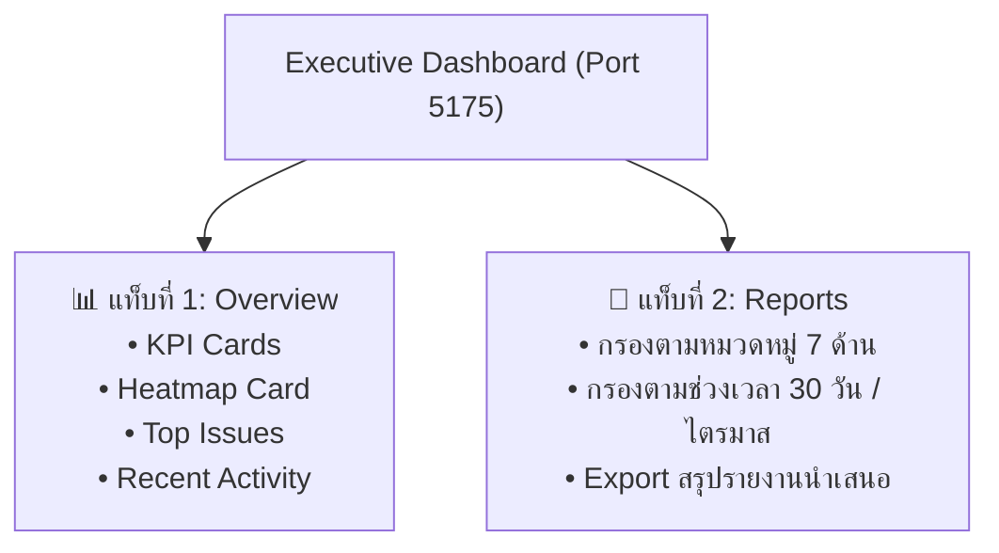

# 📊 คู่มือการใช้งานระบบสำหรับผู้บริหารมหาวิทยาลัย (Executive Dashboard Manual)
### แพลตฟอร์ม: UP Voice Executive Intelligence Dashboard
**URL สำหรับเข้าใช้งาน**: `http://localhost:5175`

---

## 📑 สารบัญ (Table of Contents)
1. [บทนำและวัตถุประสงค์สำหรับผู้บริหาร](#1-บทนำและวัตถุประสงค์สำหรับผู้บริหาร)
2. [การเข้าสู่ระบบและหน้าจอหลัก (Executive Login & Portal)](#2-การเข้าสู่ระบบและหน้าจอหลัก)
3. [ตัวชี้วัดประสิทธิภาพเชิงยุทธศาสตร์ (Strategic KPIs)](#3-ตัวชี้วัดประสิทธิภาพเชิงยุทธศาสตร์)
   - [3.1 อัตราการแก้ไขปัญหาสำเร็จ (Resolution Rate)](#31-อัตราการแก้ไขปัญหาสำเร็จ-resolution-rate)
   - [3.2 เวลาเฉลี่ยในการปิดงาน (Mean Time to Resolution - MTTR)](#32-เวลาเฉลี่ยในการปิดงาน-mean-time-to-resolution---mttr)
   - [3.3 ปริมาณเรื่องร้องเรียนและความพึงพอใจของนิสิต](#33-ปริมาณเรื่องร้องเรียนและความพึงพอใจของนิสิต)
4. [การวิเคราะห์ปัญหาเชิงพื้นที่และจุดวิกฤต (Campus Heatmap & Hotspots)](#4-การวิเคราะห์ปัญหาเชิงพื้นที่และจุดวิกฤต)
5. [การติดตามประเด็นปัญหาเร่งด่วน (Top Urgent Issues Monitoring)](#5-การติดตามประเด็นปัญหาเร่งด่วน)
6. [การจัดทำรายงานและการส่งออกข้อมูลเชิงบริหาร (Executive Reporting & Export)](#6-การจัดทำรายงานและการส่งออกข้อมูลเชิงบริหาร)
7. [การประยุกต์ใช้ข้อมูลเพื่อการจัดสรรงบประมาณและการตัดสินใจ](#7-การประยุกต์ใช้ข้อมูลเพื่อการจัดสรรงบประมาณและการตัดสินใจ)

---

## 1. บทนำและวัตถุประสงค์สำหรับผู้บริหาร

**UP Voice Executive Dashboard** พัฒนาขึ้นเป็นพิเศษเพื่อตอบโจทย์ผู้บริหารระดับสูงของมหาวิทยาลัยพะเยา (อธิการบดี, รองอธิการบดี, คณบดี, และผู้อำนวยการกอง) โดยเปลี่ยนข้อมูลเรื่องร้องเรียนกระจัดกระจาย ให้กลายเป็น **ข้อมูลเชิงลึก (Business Intelligence - BI)** เพื่อ:
* ตรวจสอบสุขภาพการดำเนินงานและการให้บริการของมหาวิทยาลัยแบบ Real-time
* ตรวจวัดประสิทธิภาพการทำงาน (SLA) ของแต่ละกองงานและคณะ
* สนับสนุนการตัดสินใจจัดสรรงบประมาณซ่อมบำรุงเชิงรุก (Data-Driven Budget Allocation)

---

## 2. การเข้าสู่ระบบและหน้าจอหลัก (Executive Login & Portal)

1. เปิดเบราว์เซอร์ไปที่: `http://localhost:5175`
2. เข้าสู่ระบบด้วยบัญชีผู้บริหาร
3. หน้าจอหลักประกอบด้วย 2 แท็บหลัก:
   * **ภาพรวมยุทธศาสตร์ (Overview Tab)**: สรุปภาพรวม KPIs, แผนที่ความร้อน และปัญหาเร่งด่วน
   * **รายงานเชิงบริหาร (Reports Tab)**: รายละเอียดตัวเลขเชิงลึกและการสร้างรายงาน

---

## 3. ตัวชี้วัดประสิทธิภาพเชิงยุทธศาสตร์ (Strategic KPIs)

แถบการ์ดด้านบน (KPI Cards) แสดงข้อมูลสุขภาพของมหาวิทยาลัย 4 มิติ:

### 3.1 อัตราการแก้ไขปัญหาสำเร็จ (Resolution Rate)
* **สูตรคำนวณ**: $(\text{จำนวนเคสที่ RESOLVED} / \text{จำนวนเคสทั้งหมด}) \times 100\%$
* สะท้อนความสามารถในการปิดเคสของหน่วยงาน เป้าหมายมาตรฐานมหาวิทยาลัยควรอยู่ที่ **$\ge 85\%$**

### 3.2 เวลาเฉลี่ยในการปิดงาน (Mean Time to Resolution - MTTR)
* แสดงจำนวนชั่วโมงหรือวันที่ใช้ในการแก้ไขปัญหาตั้งแต่สถานะ `OPEN` จนถึง `RESOLVED`
* ช่วยให้ผู้บริหารทราบว่าขั้นตอนใดเกิดปัญหาคอขวด (Bottleneck) หรือหน่วยงานใดขาดแคลนทรัพยากรช่าง

### 3.3 ปริมาณเรื่องร้องเรียนและความพึงพอใจของนิสิต
* แสดงจำนวนเรื่องร้องเรียนสะสมเปรียบเทียบกับช่วงเวลาเดียวกันของเดือนก่อน
* แสดงดัชนีการมีส่วนร่วมของนิสิต (Upvote Trend) ซึ่งสะท้อนความตื่นตัวของประชาคม มพ.

---

## 4. การวิเคราะห์ปัญหาเชิงพื้นที่และจุดวิกฤต (Campus Heatmap & Hotspots)

ส่วน **Heatmap Card** ช่วยให้ผู้บริหารมองเห็นภาพรวมของมหาวิทยาลัยพะเยาผ่านแผนผังดาวเทียม:
* **จุดวิกฤตซ้ำซาก (Recurring Trouble Spots)**: หากพิกัดใดมีวงรัศมีสีแดงเข้ม แสดงว่าเป็นพื้นที่ที่เกิดปัญหาเดิมซ้ำๆ (เช่น ระบบประปาหรือระบบไฟฟ้าบริเวณอาคารเดิมชำรุดต่อเนื่อง)
* **การตัดสินใจระดับนโยบาย**: นำข้อมูลจุดวิกฤตนี้ไปใช้พิจารณาจัดซื้อครุภัณฑ์ใหม่แทนการซ่อมแซมซ้ำซากที่สิ้นเปลืองงบประมาณ

---

## 5. การติดตามประเด็นปัญหาเร่งด่วน (Top Urgent Issues Monitoring)

ส่วน **Top Issues Card** จัดอันดับปัญหาที่มีผลกระทบสูงที่สุดในมหาวิทยาลัย:
* คัดกรองจากจำนวนการ **กดโหวต (Upvotes)** ของนิสิตและบุคลากร
* จัดกลุ่มตามความเร่งด่วน เช่น *ความปลอดภัย*, *ทางสัญจร*, *ไฟฟ้าแสงสว่าง*
* ช่วยให้ผู้บริหารสามารถโทรสั่งการหรือประสานงานกองที่เกี่ยวข้องได้ทันทีโดยไม่ต้องรอรายงานประจำเดือน

---

## 6. การจัดทำรายงานและการส่งออกข้อมูลเชิงบริหาร (Executive Reporting & Export)

คลิกที่แท็บ **"รายงานเชิงบริหาร (Reports)"**:
1. **ตัวกรองอัจฉริยะ (Smart Filters)**:
   - เลือกกรองเฉพาะหมวดหมู่งานที่สนใจ (เช่น ดูเฉพาะการเดินทางและรถเมล์ มพ.)
   - เลือกช่วงเวลา: 7 วันล่าสุด, 30 วัน, หรือกำหนดช่วงวันที่ตามรอบการประเมิน
2. **การเปิด Modal รายงานสรุป (Executive Report Modal)**:
   - กดปุ่ม **"สร้างรายงานสรุป (Generate Executive Report)"**
   - ระบบจะประมวลผลสรุปตัวเลขสถิติ กราฟวงกลมแสดงสัดส่วนปัญหา และตารางผลการดำเนินงานของแต่ละหน่วยงาน
3. **การส่งออกข้อมูล (Export)**:
   - รองรับการ Export ข้อมูลเพื่อนำไปใส่สไลด์นำเสนอในที่ประชุมกรรมการบริหารมหาวิทยาลัย หรือแนบรายงานประจำปี

---

## 7. การประยุกต์ใช้ข้อมูลเพื่อการจัดสรรงบประมาณและการตัดสินใจ

> [!TIP]
> **กรณีศึกษาการนำข้อมูลไปใช้จริงในมหาวิทยาลัยพะเยา:**
> 1. **การปรับตารางเดินรถเมล์ มพ.**: หากหมวดหมู่ Traffic มีสถิติการร้องเรียนเรื่องรอนานที่จุดจอดหอพักช่วง 08:00 - 08:30 น. สูงผิดปกติ ผู้บริหารสามารถสั่งการเพิ่มเที่ยวรถในจุดดังกล่าวได้ตรงจุด
> 2. **การเพิ่มไฟส่องสว่างจุดเสี่ยง**: หาก Heatmap ฟ้องว่าบริเวณด้านหลังหอพักหรือทางไปศูนย์การแพทย์มีแจ้งเรื่องความมืด ผู้บริหารสามารถจัดสรรงบเพื่อติดตั้งเสาไฟโซลาร์เซลล์ได้ทันท่วงที

---
*จัดทำขึ้นสำหรับการสนับสนุนการตัดสินใจเชิงนโยบาย มหาวิทยาลัยพะเยา*

