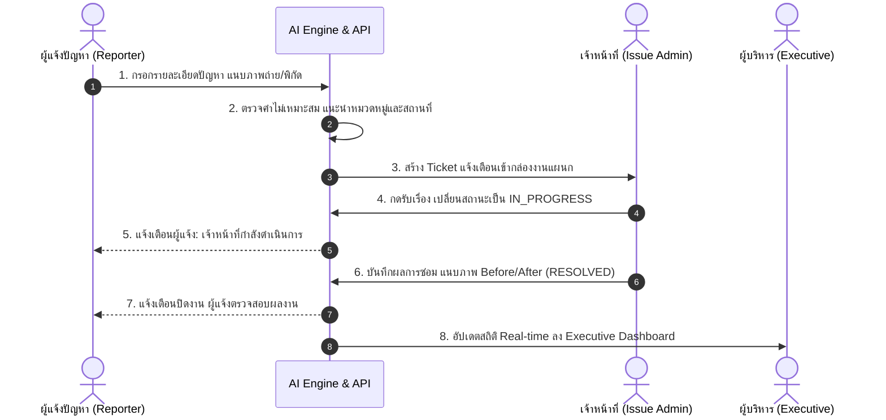

# เอกสารคู่มือการใช้งานระบบ (System User Manual)
## แพลตฟอร์มแจ้งปัญหาและบริหารจัดการเรื่องร้องเรียนอัจฉริยะ (UP Voice)
### (Enterprise Issue Tracking & Resolution Platform)

---

## 1. การควบคุมเอกสาร (Document Control)

### 1.1 ประวัติการแก้ไขเอกสาร (Document Revision History)

| เวอร์ชัน (Version) | วันที่ปรับปรุง (Date) | ผู้จัดทำ / แก้ไข (Author) | รายละเอียดการแก้ไข (Description of Changes) |
|---|---|---|---|
| **1.0.0** | 2026-10-29 | ทีมพัฒนาระบบ UP Voice | จัดทำร่างเอกสารคู่มือการใช้งานระบบฉบับสมบูรณ์ระดับองค์กร ครอบคลุม 4 บทบาทหลัก |

### 1.2 ผู้จัดทำและผู้อนุมัติเอกสาร (Authors & Approvers)

| บทบาทหน้าที่ | ชื่อ-นามสกุล | ตำแหน่ง / สังกัด | สถานะการลงนาม |
|---|---|---|---|
| **ผู้จัดทำ (Prepared By)** | ทีมพัฒนาระบบ UP Voice | วิศวกรรมซอฟต์แวร์ / วิทยาการคอมพิวเตอร์ | ตรวจทานแล้ว |
| **ผู้ตรวจสอบ (Reviewed By)** | คณะกรรมการโครงงาน | สาขาเทคโนโลยีสารสนเทศ | รอการอนุมัติ |
| **ผู้อนุมัติ (Approved By)** | หัวหน้าโครงการ / อาจารย์ที่ปรึกษา | มหาวิทยาลัยพะเยา | รอการอนุมัติ |

### 1.3 การอ้างอิงและขอบเขตเอกสาร (References & Scope)
เอกสารฉบับนี้จัดทำขึ้นเพื่อเป็นคู่มือมาตรฐานการปฏิบัติงาน (Standard Operating Procedure - SOP) และแนวทางการใช้งานฟังก์ชันของระบบงานคอมพิวเตอร์สำหรับ **แพลตฟอร์มแจ้งปัญหาและบริหารจัดการเรื่องร้องเรียน (UP Voice)** โดยครอบคลุมกระบวนการตั้งแต่การบันทึกเรื่องร้องเรียน การประมวลผลคำและแนะนำหมวดหมู่อัจฉริยะ การกระจายงานสู่เจ้าหน้าที่ผู้รับผิดชอบ การบันทึกปิดเคสพร้อมหลักฐานเชิงประจักษ์ จนถึงการจัดทำแดชบอร์ดรายงานเชิงบริหารสำหรับผู้บริหารระดับสูง

---

## 2. สารบัญ (Table of Contents)

- **1. การควบคุมเอกสาร (Document Control)**
  - 1.1 ประวัติการแก้ไขเอกสาร
  - 1.2 ผู้จัดทำและผู้อนุมัติเอกสาร
  - 1.3 การอ้างอิงและขอบเขตเอกสาร
- **2. สารบัญ (Table of Contents)**
- **3. บทนำและสถาปัตยกรรมระบบ (Introduction & Overview)**
  - 3.1 ภาพรวมโปรแกรม วัตถุประสงค์ และการไหลของข้อมูล (System Workflow & Data Flow)
  - 3.2 เมทริกซ์สิทธิ์การใช้งานตามบทบาท (User Roles & Permissions Matrix)
  - 3.3 สภาพแวดล้อมและความต้องการขั้นต่ำของระบบ (System Requirements)
- **4. การเข้าใช้งานระบบและการจัดการโปรไฟล์ (Access & Profile Management)**
  - 4.1 การลงชื่อเข้าใช้งานระบบ (Single Sign-On & Standard Login)
  - 4.2 ขั้นตอนกรณีลืมรหัสผ่าน (Password Recovery Workflow)
  - 4.3 การจัดการข้อมูลส่วนตัวและตั้งค่าการแจ้งเตือน (Profile & Notification Settings)
- **5. คู่มือการใช้งานแยกตามบทบาทและหน้าจอ (Screen-by-Screen Detailed Manual)**
  - **5.1 สำหรับ "ผู้แจ้งปัญหา (Reporter / End User)"**
    - 5.1.1 หน้าจอสร้างและบันทึกเรื่องร้องเรียนใหม่ (Create Issue Screen)
    - 5.1.2 หน้าจอติดตามสถานะและประวัติ Ticket ส่วนตัว (Ticket Tracking & History Screen)
    - 5.1.3 หน้าจอแสดงผลการแก้ไขและรายละเอียดงาน (Issue Detail & Resolution View)
  - **5.2 สำหรับ "แอดมินจัดการแต่ละปัญหา (Department / Issue Admin)"**
    - 5.2.1 หน้าจอกระดานจัดการตั๋วงาน (Ticket Workspace / Kanban Board)
    - 5.2.2 หน้าจอการรับเรื่องและปรับสถานะงาน (Ticket Acceptance & In-Progress Update)
    - 5.2.3 หน้าจอบันทึกผลการแก้ไขและปิดเคสพร้อมแนบหลักฐาน (Resolution & Closure Screen)
  - **5.3 สำหรับ "แอดมินใหญ่ (Super Admin)"**
    - 5.3.1 หน้าจอจัดการข้อมูลหลัก: หมวดหมู่ปัญหาและระดับความเร่งด่วน (Master Categories)
    - 5.3.2 หน้าจอจัดการข้อมูลหลัก: อาคาร สถานที่ และพิกัดแผนที่ (Campus Buildings & GPS)
    - 5.3.3 หน้าจอจัดการบัญชีผู้ใช้และกำหนดสิทธิ์ (User & Role Permission Management)
    - 5.3.4 หน้าจอการตั้งค่าระบบและประวัติการตรวจสอบ (System Config & Audit Logs)
  - **5.4 สำหรับ "ผู้บริหาร (Management / Executive)"**
    - 5.4.1 หน้าจอแดชบอร์ดสรุปภาพรวมเชิงยุทธศาสตร์ (Executive Intelligence Dashboard)
    - 5.4.2 ตัวกรองข้อมูลระดับองค์กร (Enterprise Strategic Filters)
    - 5.4.3 หน้าจอการสร้างและส่งออกรายงานเชิงวิเคราะห์ (Executive Report Export)
- **6. ภาคผนวกและข้อผิดพลาดที่พบบ่อย (Appendix & Troubleshooting)**

---

## 3. บทนำและสถาปัตยกรรมระบบ (Introduction & Overview)

### 3.1 ภาพรวมโปรแกรม วัตถุประสงค์ และการไหลของข้อมูล (System Workflow & Data Flow)

ระบบแจ้งปัญหาและบริหารจัดการเรื่องร้องเรียนเป็นแพลตฟอร์มศูนย์กลางที่เชื่อมต่อผู้ใช้งาน 4 กลุ่มเข้าด้วยกัน โดยมีขั้นตอนการไหลของข้อมูลและวงจรชีวิตของตั๋วงาน (Ticket Lifecycle) ดังนี้:

```text
+-------------------+       +--------------------+       +----------------------+       +--------------------+
|  1. ผู้แจ้งปัญหา   | ----> | 2. ระบบ AI กรองงาน  | ----> | 3. เจ้าหน้าที่ประจำกอง | ----> | 4. ปิดงาน/แจ้งผล   |
| (Reporter/Student)|       | (Categorization)   |       |   (Issue Admin)      |       |  (Resolved/Closed) |
+-------------------+       +--------------------+       +----------------------+       +--------------------+
          |                                                          |                            |
          |                      +-----------------------------------+                            |
          v                      v                                                                v
+----------------------------------------------------------------------------------------------------+
|                                    ฐานข้อมูลกลางระบบ (Central DB)                                   |
+----------------------------------------------------------------------------------------------------+
          |                                                                                       |
          v                                                                                       v
+-------------------------------+                                           +----------------------------------+
| 5. แอดมินใหญ่ (Super Admin)    |                                           | 6. ผู้บริหาร (Management/Exec)   |
| ดูแล Master Data, Users, Audit|                                           | ตรวจสอบ SLA, KPI, Hotspot Heatmap|
+-------------------------------+                                           +----------------------------------+
```



---

### 3.2 เมทริกซ์สิทธิ์การใช้งานตามบทบาท (User Roles & Permissions Matrix)

| รายการฟังก์ชัน / โมดูลระบบ | ผู้แจ้งปัญหา (Reporter) | เจ้าหน้าที่ประจำกอง (Issue Admin) | แอดมินใหญ่ (Super Admin) | ผู้บริหาร (Executive) |
|---|:---:|:---:|:---:|:---:|
| **ส่งเรื่องร้องเรียนใหม่** | ✅ | ✅ | ✅ | ❌ |
| **ติดตามสถานะตั๋วตนเอง** | ✅ | ✅ | ✅ | ❌ |
| **แสดงความเห็น / โหวตปัญหา (Upvote)** | ✅ | ✅ | ✅ | ❌ |
| **ดูรายการตั๋วในหมวดหมู่ที่ตนรับผิดชอบ** | ❌ | ✅ | ✅ | ❌ |
| **ปรับสถานะตั๋ว (OPEN ➔ IN_PROGRESS)** | ❌ | ✅ | ✅ | ❌ |
| **บันทึกปิดงานและแนบรูปภาพ Before/After** | ❌ | ✅ | ✅ | ❌ |
| **โอนย้ายหมวดหมู่ตั๋ว (Ticket Re-routing)** | ❌ | ✅ | ✅ | ❌ |
| **จัดการข้อมูลหลัก (Master Data: อาคาร/หมวดหมู่)** | ❌ | ❌ | ✅ | ❌ |
| **จัดการบัญชีผู้ใช้งาน และระบบบทลงโทษ (Strike)** | ❌ | ❌ | ✅ | ❌ |
| **ตั้งค่าพารามิเตอร์ AI และดู Audit Logs** | ❌ | ❌ | ✅ | ❌ |
| **ดูภาพรวมยุทธศาสตร์ และ Executive KPI** | ❌ | ❌ | ✅ | ✅ |
| **ดูแผนที่ความร้อนจุดวิกฤต (Campus Heatmap)** | ❌ | ❌ | ✅ | ✅ |
| **สร้างและส่งออกรายงานสรุปผู้บริหาร (Export)** | ❌ | ❌ | ✅ | ✅ |

---

### 3.3 สภาพแวดล้อมและความต้องการขั้นต่ำของระบบ (System Requirements)
* **โปรแกรมเปิดเว็บ (Web Browser)**: Google Chrome (เวอร์ชัน 110 ขึ้นไป), Microsoft Edge (เวอร์ชัน 110 ขึ้นไป), Mozilla Firefox หรือ Apple Safari
* **การเชื่อมต่อเครือข่าย**: อินเทอร์เน็ตความเร็วไม่ต่ำกว่า 10 Mbps รองรับทั้งเครือข่ายภายในมหาวิทยาลัย (UP Intranet) และเครือข่ายภายนอก
* **อุปกรณ์ที่รองรับ**: คอมพิวเตอร์ตั้งโต๊ะ (PC), แล็ปท็อป (Laptop), แท็บเล็ต (Tablet) หรือสมาร์ตโฟน (Responsive Web Design)

---

## 4. การเข้าใช้งานระบบและการจัดการโปรไฟล์ (Access & Profile Management)

### 4.1 การลงชื่อเข้าใช้งานระบบ (Single Sign-On & Standard Login)

```text
[รูปที่ 4.1: หน้าต่างลงชื่อเข้าใช้งานระบบ Single Sign-On และ Standard Login]
```

1. เปิดเว็บเบราว์เซอร์และระบุ URL ของระบบงาน
2. ผู้ใช้งานสามารถเลือกวิธีการเข้าสู่ระบบได้ 2 ช่องทาง:
   * **ช่องทางที่ 1: มหาวิทยาลัย Single Sign-On (UP SSO)** — คลิกที่ปุ่ม *"เข้าสู่ระบบด้วย UP Mail / SSO"* ระบบจะเปลี่ยนเส้นทางไปยัง Identity Provider ของมหาวิทยาลัย กรอกอีเมลสถาบันและรหัสผ่านเพื่อเข้าใช้งานทันที
   * **ช่องทางที่ 2: Standard Authentication** — สำหรับบัญชีแอดมินหรือผู้ใช้ทั่วไป กรอก *อีเมล (Email)* และ *รหัสผ่าน (Password)* จากนั้นกดปุ่ม *"เข้าสู่ระบบ (Sign In)"*
3. ระบบจะตรวจสอบความถูกต้องของสิทธิ์ (Role RBAC) และนำทางผู้ใช้งานไปยังหน้าจอที่สอดคล้องกับบทบาทโดยอัตโนมัติ

---

### 4.2 ขั้นตอนกรณีลืมรหัสผ่าน (Password Recovery Workflow)

```text
[รูปที่ 4.2: หน้าต่างแบบฟอร์มขอตั้งรหัสผ่านใหม่ (Password Recovery Modal)]
```

1. ในหน้าจอลงชื่อเข้าใช้งาน คลิกที่ข้อความลิงก์ *"ลืมรหัสผ่าน? (Forgot Password)"*
2. ระบุอีเมลที่ใช้ลงทะเบียนไว้ในระบบลงในช่องกรอกข้อมูล
3. คลิกปุ่ม *"ส่งลิงก์รีเซ็ตรหัสผ่าน"* ระบบจะสร้างโทเค็นรักษาความปลอดภัย (Time-limited Token) และจัดส่งลิงก์ไปยังกล่องจดหมายอีเมลของผู้ใช้
4. ผู้ใช้เปิดอีเมลและคลิกลิงก์เพื่อกำหนดรหัสผ่านใหม่ โดยต้องเป็นไปตามนโยบายความปลอดภัยของระบบ (ความยาวอย่างน้อย 8 ตัวอักษร ประกอบด้วยตัวอักษรพิมพ์ใหญ่ พิมพ์เล็ก และตัวเลข)

---

### 4.3 การจัดการข้อมูลส่วนตัวและตั้งค่าการแจ้งเตือน (Profile & Notification Settings)

```text
[รูปที่ 4.3: หน้าจอการตั้งค่าโปรไฟล์ผู้ใช้งานและการแจ้งเตือน]
```

* **การแก้ไขข้อมูลส่วนตัว**: เข้าเมนู *"โปรไฟล์ (User Profile)"* สามารถปรับปรุงข้อมูลเบอร์โทรศัพท์ติดต่อภายใน แผนกสังกัด และภาพถ่ายประจำตัว
* **การเปลี่ยนรหัสผ่าน (Change Password)**: กรอกรหัสผ่านเดิม 1 ครั้ง และกรอกรหัสผ่านใหม่พร้อมยืนยันความถูกต้อง
* **การตั้งค่าการแจ้งเตือน (Notification Preferences)**: 
  * สวิตช์เปิด-ปิดการแจ้งเตือนผ่านอีเมล (Email Notifications Toggle)
  * สวิตช์เปิด-ปิดการแจ้งเตือนแบบพุชในระบบ (In-App Notification Banner)

---

## 5. คู่มือการใช้งานแยกตามบทบาทและหน้าจอ (Screen-by-Screen Detailed Manual)

---

### 5.1 สำหรับ "ผู้แจ้งปัญหา (Reporter / End User)"

> 👤 **กลุ่มผู้ใช้งานเป้าหมาย**: นิสิต, คณาจารย์, บุคลากรทั่วไป และผู้รับบริการ  
> 🌐 **URL หน้าจอ**: `http://localhost:5174/` (Public Web Portal)  
> 🔒 **ขอบเขตสิทธิ์**: ใช้งานได้เฉพาะฟังก์ชันการแจ้งปัญหา ติดตามประวัติส่วนตัว ส่องฟีดสาธารณะ และร่วมโหวตปัญหา ไม่สามารถเข้าถึงแดชบอร์ดจัดการงานของเจ้าหน้าที่ได้

---

#### 5.1.1 หน้าจอสร้างและบันทึกเรื่องร้องเรียนใหม่ (Create Issue Screen)

* **วัตถุประสงค์และคำอธิบายหน้าจอ (Screen Purpose & Description)**:  
  ใช้สำหรับบันทึกข้อมูลเรื่องร้องเรียน ปัญหาโครงสร้างพื้นฐาน อุปกรณ์ชำรุด หรือข้อเสนอแนะ โดยมีระบบปัญญาประดิษฐ์ (AI NLP) คอยตรวจจับคำหยาบคายอัตโนมัติ แนะนำหมวดหมู่ที่เหมาะสม และสกัดชื่ออาคารสถานที่จากข้อความเพื่อช่วยอำนวยความสะดวกแก่ผู้แจ้ง

```text
[รูปที่ 5.1.1: หน้าจอแบบฟอร์มบันทึกเรื่องร้องเรียนใหม่ พร้อมระบบ AI อัจฉริยะ]
```

* **รายละเอียดฟิลด์ในฟอร์มบันทึกข้อมูล (Add Form Fields Specification)**:

| ชื่อฟิลด์ข้อมูล (Field Name) | ฟิลด์จำเป็น (*) | ชนิดข้อมูล / คอนโทรล (Input Type) | คำอธิบายและเงื่อนไขการตรวจสอบ (Validation Rules) |
|---|:---:|---|---|
| **หัวข้อเรื่องร้องเรียน (Issue Title)** | `*` จำเป็น | `Textbox` (ข้อความสั้น) | ระบุประเด็นปัญหาอย่างกระชับ ความยาว 5 - 120 ตัวอักษร เช่น *"แอร์ห้อง ICT 1204 ไม่เย็น"* |
| **รายละเอียดปัญหา (Description)** | `*` จำเป็น | `Textarea` (ข้อความหลายบรรทัด) | อธิบายข้อเท็จจริง สภาพปัญหา ความยาว 10 - 2,000 ตัวอักษร โดยมีระบบคัดกรองคำหยาบคายแบบ Real-time |
| **หมวดหมู่ปัญหา (Category)** | `*` จำเป็น | `Dropdown` พร้อมป้าย AI Suggestion | เลือก 1 ใน 7 หมวดหมู่ (ระบบจะไฮไลต์ค่าที่ AI แนะนำให้อัตโนมัติ ผู้ใช้สามารถคลิกเปลี่ยนเองได้) |
| **อาคาร / สถานที่ (Building Location)** | `*` จำเป็น | `Dropdown` หรือ ค้นหาอัตโนมัติ | เลือกรายชื่ออาคาร 45 แห่งในมหาวิทยาลัย (สกัดชื่ออาคารจากข้อความให้อัตโนมัติ) |
| **รายละเอียดจุดเกิดเหตุ (Specific Spot)** | ไม่บังคับ | `Textbox` | ระบุหมายเลขห้อง ชั้น หรือเสาไฟฟ้า เช่น *"ชั้น 2 โซนหน้าห้องน้ำชาย"* |
| **การปักหมุดบนแผนที่ (GPS Map Pin)** | ไม่บังคับ | `Interactive Map Pinpoint` | แผนที่ลากเลื่อนหมุดพิกัดละติจูด/ลองจิจูด เพื่อระบุตำแหน่งเกิดเหตุที่แม่นยำ |
| **รูปภาพหลักฐาน (Attachments)** | ไม่บังคับ | `File Upload / Drag & Drop` | แนบรูปถ่ายปัญหา รองรับไฟล์ `.jpg`, `.png`, `.webp` สูงสุด 5 รูป ขนาดรูปละไม่เกิน 5 MB |
| **การเปิดเผยข้อมูล (Visibility Type)** | `*` จำเป็น | `Radio Button` | เลือกระดับความเป็นส่วนตัว:<br/>- 🌐 **สาธารณะ (Public)**: แสดงบนหน้าฟีดส่วนรวม<br/>- 🔒 **เฉพาะเจ้าหน้าที่ (Internal Only)**: เห็นเฉพาะผู้รับผิดชอบ<br/>- 👤 **ไม่ระบุตัวตน (Anonymous)**: แสดงบนฟีดแต่ซ่อนชื่อผู้แจ้ง |

* **ขั้นตอนการบันทึกข้อมูล (Operational Steps)**:
  1. ผู้ใช้กรอกหัวข้อและรายละเอียดปัญหา
  2. สังเกตแถบคำแนะนำจาก AI ด้านล่าง หากระบบวิเคราะห์หมวดหมู่และสถานที่ถูกต้อง ให้คงค่านั้นไว้
  3. แนบไฟล์ภาพถ่ายสภาพความชำรุด (ถ้ามี)
  4. เลือกระดับความเป็นส่วนตัวที่ต้องการ
  5. คลิกปุ่ม **"ส่งเรื่องร้องเรียน (Submit Report)"**
  6. ระบบจะประมวลผล สร้างหมายเลขตั๋วงาน (Ticket Code เช่น `FAC-2026-0128`) และแสดงหน้าต่างแจ้งเตือนสำเร็จ

---

#### 5.1.2 หน้าจอกระดานติดตามสถานะและประวัติส่วนตัว (Ticket Tracking & History Screen)

* **วัตถุประสงค์และคำอธิบายหน้าจอ (Screen Purpose & Description)**:  
  ใช้สำหรับค้นหา ติดตามความคืบหน้า และตรวจสอบประวัติเรื่องร้องเรียนทั้งหมดที่ตนเองเคยแจ้งไว้ในระบบ

```text
[รูปที่ 5.1.2: หน้าจอรายการประวัติติดตามสถานะตั๋วงานส่วนบุคคล]
```

* **ส่วนการค้นหาและตัวกรองข้อมูล (Search, Filter & Views)**:
  * **ช่องค้นหารหัสตั๋ว (Search by Ticket ID)**: ช่องพิมพ์ค้นหาด่วนด้วยรหัสตั๋ว เช่น `FAC-2026-0128`
  * **แท็บกรองสถานะ (Status Tabs)**: ทั้งหมด (All), รอรับเรื่อง (Open), กำลังดำเนินการ (In Progress), แก้ไขแล้ว (Resolved)
  * **ตัวกรองหมวดหมู่ (Category Filter)**: เลือกเฉพาะหมวดหมู่ที่ต้องการดูข้อมูล

* **รายละเอียดคอลัมน์ของตารางข้อมูล (Table Columns Description)**:

| ชื่อคอลัมน์ (Column Header) | ชนิดข้อมูล (Data Type) | ความหมายและรูปแบบการแสดงผล (Description & Format) |
|---|---|---|
| **รหัสตั๋วงาน (Ticket ID)** | String (Link) | รหัสอ้างอิงตั๋วงาน คลิกเพื่อเปิดดูรายละเอียดฉบับเต็ม |
| **หัวข้อเรื่อง (Subject)** | Text | หัวข้อปัญหาที่แจ้งไว้ พร้อมไอคอนรูปภาพ (ถ้ามีไฟล์แนบ) |
| **หมวดหมู่ (Category)** | Badge (Color) | ป้ายระบุหมวดหมู่ปัญหาและรหัสสีประจำหน่วยงาน |
| **สถานที่เกิดเหตุ (Location)** | Text | ชื่ออาคารและบริเวณที่ระบุไว้ |
| **วันที่แจ้งเรื่อง (Created Date)** | DateTime | วันที่และเวลาที่บันทึกข้อมูลเข้าระบบ (DD/MM/YYYY HH:mm) |
| **สถานะการดำเนินงาน (Status)** | Status Badge | ป้ายสถานะปัจจุบัน (OPEN / IN_PROGRESS / RESOLVED / CLOSED) |
| **การจัดการ (Actions)** | Button Icon | ปุ่มกดเปิดดูรายละเอียดเชิงลึก (View Details) |

---

#### 5.1.3 หน้าจอแสดงผลการแก้ไขและรายละเอียดตั๋ว (Issue Detail & Resolution View)

* **วัตถุประสงค์และคำอธิบายหน้าจอ (Screen Purpose & Description)**:  
  แสดงรายละเอียดความคืบหน้าของงาน บันทึกข้อความการทำงานของเจ้าหน้าที่ และรูปภาพเปรียบเทียบ Before vs. After เมื่อการแก้ไขเสร็จสิ้น

```text
[รูปที่ 5.1.3: หน้าต่างแสดงรายละเอียดตั๋วงานและภาพเปรียบเทียบ Before & After]
```

* **องค์ประกอบบนหน้าจอ**:
  * **แถบไทม์ไลน์สถานะ (Status Stepper Bar)**: แสดง 4 ขั้นตอน `OPEN` ➜ `IN_PROGRESS` ➜ `RESOLVED` ➜ `CLOSED` พร้อมระบุวันเวลาที่สถานะเปลี่ยน
  * **กล่องข้อมูลการแก้ไขจากเจ้าหน้าที่ (Resolution Box)**: ปรากฏเมื่อสถานะเป็น `RESOLVED` แสดงชื่อหน่วยงานที่รับผิดชอบ บันทึกชี้แจง และเบอร์ติดต่อช่าง
  * **จุดเปรียบเทียบภาพหลักฐาน (Before & After Comparison Viewer)**: แสดงภาพถ่ายสภาพปัญหาก่อนซ่อม เปรียบเทียบเคียงข้างกับภาพถ่ายหลังดำเนินการซ่อมแซมเสร็จสิ้น

---

### 5.2 สำหรับ "แอดมินจัดการแต่ละปัญหา (Department / Issue Admin)"

> 🛠️ **กลุ่มผู้ใช้งานเป้าหมาย**: หัวหน้างานและเจ้าหน้าที่ประจำกอง (เช่น กองอาคารสถานที่, งานจราจร, งานความสะอาด, กองเทคโนโลยีฯ)  
> 🌐 **URL หน้าจอ**: `http://localhost:5173/category-admin`  
> 🔒 **ขอบเขตสิทธิ์**: บริหารจัดการตั๋วงานเฉพาะในหมวดหมู่ที่ได้รับมอบหมายเท่านั้น ไม่สามารถดูข้อมูลข้ามหมวดหมู่อื่น หรือแก้ไขข้อมูลโครงสร้างหลักของระบบได้

---

#### 5.2.1 หน้าจอกระดานจัดการตั๋วงาน (Ticket Workspace / Kanban Board)

* **วัตถุประสงค์และคำอธิบายหน้าจอ (Screen Purpose & Description)**:  
  เป็นศูนย์ปฏิบัติการหลักของเจ้าหน้าที่ประจำหมวดหมู่ ออกแบบในรูปแบบกระดาน Kanban และตารางข้อมูล เพื่อคัดกรองงาน ตรวจสอบความเร่งด่วน และจัดสรรช่างเข้าพื้นที่

```text
[รูปที่ 5.2.1: หน้าจอกระดาน Kanban Board สำหรับจัดการตั๋วงานประจำหมวดหมู่]
```

* **ส่วนการค้นหาและตัวกรอง (Search, Filter & Views)**:
  * **ตัวสลับมุมมอง (View Toggle)**: เลือกระหว่างมุมมองกระดาน (Kanban View) หรือมุมมองตาราง (Table View)
  * **ตัวกรองระดับความสำคัญ (Priority Filter)**: ต่ำ (Low), ปานกลาง (Medium), สูง (High), วิกฤต (Critical)
  * **ตัวจัดเรียงคะแนนโหวต (Sort by Upvotes)**: เรียงลำดับเรื่องที่มีนิสิตกดเห็นด้วยมากที่สุดขึ้นก่อน

* **รายละเอียดการ์ดงานบนกระดาน Kanban (Kanban Columns & Card Structure)**:

| คอลัมน์สถานะ (Column) | สีประจำแถบ | สิ่งที่ต้องดำเนินการของเจ้าหน้าที่ (Admin Action) |
|---|---|---|
| **1. งานรับใหม่ (OPEN)** | สีส้มเหลือง | ตรวจสอบเนื้อหา พิกัด และความถูกต้องของงาน หากถูกต้องให้กดรับงาน |
| **2. กำลังดำเนินการ (IN_PROGRESS)** | สีน้ำเงิน | ประสานงานทีมช่าง สั่งซื้ออะไหล่ หรือลงพื้นที่แก้ไขงาน |
| **3. แก้ไขเสร็จสิ้น (RESOLVED)** | สีเขียว | แนบภาพหลักฐานการซ่อมเสร็จ บันทึกสรุปงาน และกดปิดเคส |

---

#### 5.2.2 หน้าจอการรับเรื่องและปรับสถานะงาน (Ticket Acceptance & In-Progress Update)

* **วัตถุประสงค์และคำอธิบายหน้าจอ (Screen Purpose & Description)**:  
  ใช้เมื่อเจ้าหน้าที่เปิดอ่านรายละเอียดปัญหา และพร้อมส่งทีมช่างลงปฏิบัติงาน หรือส่งต่อเรื่องกรณีปัญหาอยู่นอกขอบเขตความรับผิดชอบ

```text
[รูปที่ 5.2.2: หน้าต่างแสดงรายละเอียดตั๋วงานและปุ่มกดรับเรื่องเพื่อเริ่มปฏิบัติงาน]
```

* **ขั้นตอนการรับเรื่องและปรับสถานะ**:
  1. คลิกที่การ์ดตั๋วงานในคอลัมน์ **OPEN** เพื่อเปิดหน้าต่างรายละเอียด
  2. ตรวจสอบสถานที่ ภาพถ่าย และเบอร์ติดต่อผู้แจ้ง
  3. **กรณีรับเรื่องเพื่อดำเนินการ**:
     - คลิกปุ่ม **"รับเรื่องและเริ่มดำเนินการ (Accept & In Progress)"**
     - ระบุผู้รับผิดชอบหลัก (Assigned Staff) และกำหนดวันที่คาดว่าจะแล้วเสร็จ (Estimated Finish Date)
     - ระบบจะปรับสถานะตั๋วเป็นการ์ดในช่อง `IN_PROGRESS` อัตโนมัติ พร้อมส่งข้อความแจ้งเตือนถึงผู้แจ้ง
  4. **กรณีส่งต่อข้ามหมวดหมู่ (Ticket Re-routing)**:
     - หากพบว่าเรื่องแจ้งผิดหมวด (เช่น เรื่องขยะแต่ส่งมาหมวดอาคาร)
     - คลิกปุ่ม **"ส่งต่อหมวดหมู่อื่น (Re-route)"**
     - เลือกหมวดหมู่ปลายทางที่ถูกต้อง และกรอกเหตุผลการส่งต่อ ระบบจะโอนตั๋วไปยังกระดานของแอดมินหมวดนั้นทันที

---

#### 5.2.3 หน้าจอบันทึกผลการแก้ไขและปิดเคสพร้อมแนบหลักฐาน (Resolution & Closure Screen)

* **วัตถุประสงค์และคำอธิบายหน้าจอ (Screen Purpose & Description)**:  
  ใช้สำหรับบันทึกสรุปผลงานเชิงประจักษ์ อัปโหลดภาพถ่ายหลังการแก้ไข และเปลี่ยนสถานะงานเป็น `RESOLVED` เพื่อยืนยันความโปร่งใส

```text
[รูปที่ 5.2.3: หน้าต่างบันทึกผลการแก้ไขและแนบภาพถ่ายหลักฐาน Before/After]
```

* **รายละเอียดฟิลด์ในฟอร์มบันทึกปิดงาน (Resolution Form Fields Specification)**:

| ชื่อฟิลด์ข้อมูล (Field Name) | ฟิลด์จำเป็น (*) | ชนิดข้อมูล / คอนโทรล (Input Type) | คำอธิบายและเงื่อนไขการตรวจสอบ (Validation Rules) |
|---|:---:|---|---|
| **บันทึกสรุปการแก้ไข (Resolution Note)** | `*` จำเป็น | `Textarea` | อธิบายการแก้ปัญหา เช่น *"เปลี่ยนบัลลาสต์และหลอดไฟ LED 18W จุดทางเดินเสร็จสิ้น"* อย่างน้อย 10 ตัวอักษร |
| **ภาพถ่ายหลังการแก้ไข (After Image)** | `*` จำเป็น | `File Upload` | แนบภาพถ่ายพื้นที่จริงหลังแก้ไขเสร็จสมบูรณ์ (.jpg, .png สูงสุด 5 MB) เพื่อนำไปประกบกับภาพ Before |
| **ค่าใช้จ่ายในการซ่อมแซม (Cost - Optional)** | ไม่บังคับ | `Numeric Textbox` (ทศนิยม 2 ตำแหน่ง) | ระบุงบประมาณที่ใช้ไป (บาท) สำหรับใช้ในระบบสถิติเชิงบริหาร |
| **วันที่ดำเนินการแล้วเสร็จ (Resolved Date)** | `*` จำเป็น | `Datepicker` (วันที่และเวลา) | ค่าเริ่มต้นเป็นวันเวลาปัจจุบัน (Timestamp ป้องกันการแก้ไขย้อนหลังเกิน 24 ชม.) |

---

### 5.3 สำหรับ "แอดมินใหญ่ (Super Admin)"

> ⚙️ **กลุ่มผู้ใช้งานเป้าหมาย**: ผู้ดูแลระบบส่วนกลาง (Central System Administrator), ฝ่ายเทคโนโลยีสารสนเทศ  
> 🌐 **URL หน้าจอ**: `http://localhost:5173/super-admin`  
> 🔒 **ขอบเขตสิทธิ์**: สิทธิ์ระดับสูงสุด (Master Privileges) สามารถเข้าถึง จัดการ และกำหนดค่าได้ทุกส่วนของระบบ รวมถึงการตรวจสอบ Audit Logs

---

#### 5.3.1 หน้าจอจัดการข้อมูลหลัก: หมวดหมู่และสถานที่ (Master Data Management)

* **วัตถุประสงค์และคำอธิบายหน้าจอ (Screen Purpose & Description)**:  
  ใช้สำหรับกำหนดโครงสร้างพื้นฐานของระบบ ได้แก่ หมวดหมู่ปัญหา 7 ด้าน, ตัวย่อรหัสตั๋ว, สีประจำหมวด และฐานข้อมูลพิกัดอาคาร 45 แห่งในมหาวิทยาลัย

```text
[รูปที่ 5.3.1: หน้าจอจัดการข้อมูลหลัก Master Data (หมวดหมู่และพิกัดอาคารสถานที่)]
```

* **รายละเอียดคอลัมน์ของตารางข้อมูลหมวดหมู่ (Category Master Table)**:

| ชื่อคอลัมน์ | ชนิดข้อมูล | คำอธิบายและการแสดงผล |
|---|---|---|
| **รหัสย่อ (Prefix)** | String (3 ตัวอักษร) | รหัสนำหน้าตั๋ว เช่น `FAC`, `TRF`, `SAF`, `CLN`, `EDU`, `NET`, `OTH` |
| **ชื่อหมวดหมู่ (Category Name)** | String | ชื่อภาษาไทยและภาษาอังกฤษของหมวดหมู่ปัญหา |
| **รหัสสี (Hex Color)** | Color Code | รหัสสีแสดงผลบนแผนภูมิและป้ายสถานะ เช่น `#2563EB` |
| **สถานะการใช้งาน (Active Status)** | `Toggle Switch` | สวิตช์เปิด-ปิดการใช้งานหมวดหมู่ |
| **การจัดการ (Action)** | Button Icon | ปุ่มแก้ไข (Edit) / ดูรายละเอียด (View) |

* **รายละเอียดฟิลด์ในฟอร์มเพิ่ม/แก้ไขอาคารสถานที่ (Building Form Fields Specification)**:

| ชื่อฟิลด์ข้อมูล | ฟิลด์จำเป็น (*) | ชนิดข้อมูล / คอนโทรล | คำอธิบายและเงื่อนไข |
|---|:---:|---|---|
| **ชื่ออาคารภาษาไทย** | `*` จำเป็น | `Textbox` | เช่น *"อาคารเทคโนโลยีสารสนเทศและการสื่อสาร (ICT)"* |
| **ชื่อย่อ / รหัสอาคาร** | `*` จำเป็น | `Textbox` | เช่น *"ICT"*, *"CE"*, *"PKY"* |
| **พิกัดละติจูด (Latitude)** | `*` จำเป็น | `Numeric Textbox` (Float) | ค่าพิกัดละติจูด เช่น `19.028450` |
| **พิกัดลองจิจูด (Longitude)** | `*` จำเป็น | `Numeric Textbox` (Float) | ค่าพิกัดลองจิจูด เช่น `99.897120` |
| **คลิกเลือกบนแผนที่** | ไม่บังคับ | `Interactive Map` | คลิกบนแผนที่เพื่ออัปเดตค่าพิกัดลงฟอร์มอัตโนมัติ |

---

#### 5.3.2 หน้าจอจัดการบัญชีผู้ใช้และกำหนดสิทธิ์ (User & Role Permission Management)

* **วัตถุประสงค์และคำอธิบายหน้าจอ (Screen Purpose & Description)**:  
  ใช้สำหรับตรวจสอบรายชื่อผู้ใช้งานทั้งหมดในระบบ การเชิญแอดมินหมวดหมู่ใหม่ และการบังคับใช้มาตรการลงโทษตามระบบตัดแต้มความประพฤติ (Strike System)

```text
[รูปที่ 5.3.2: หน้าจอจัดการบัญชีผู้ใช้งาน สิทธิ์แอดมิน และระบบ Strike Management]
```

* **รายละเอียดคอลัมน์ของตารางข้อมูลผู้ใช้งาน (User Management Table)**:

| ชื่อคอลัมน์ | ชนิดข้อมูล | คำอธิบายและการแสดงผล |
|---|---|---|
| **ชื่อ-นามสกุล / รหัส** | Text | ชื่อผู้ใช้ รหัสนิสิต หรือรหัสพนักงาน |
| **อีเมล (Email)** | Text | อีเมลที่ใช้ล็อกอินเข้าสู่ระบบ |
| **บทบาทสิทธิ์ (Role)** | Badge | `student`, `staff`, `category_admin`, `super_admin` |
| **แต้มตักเตือน (Strike Count)** | Number / Badge | จำนวนแต้มสะสม (0 / 3) หากครบ 3 แต้มจะแสดงป้าย `BANNED` สีแดง |
| **สถานะบัญชี (Account Status)** | Status Badge | ใช้งานปกติ (Active) / ถูกระงับสิทธิ์ (Suspended) |
| **การจัดการ (Actions)** | Button Group | ปุ่มเพิ่ม Strike, ปุ่มปลดแบน (Unban), ปุ่มเปลี่ยนสิทธิ์ |

* **ขั้นตอนการเชิญเจ้าหน้าที่หมวดหมู่ใหม่ (Category Admin Invite Workflow)**:
  1. คลิกปุ่ม **"เชิญเจ้าหน้าที่ใหม่ (Invite Category Admin)"**
  2. ระบุอีเมลบุคลากรของมหาวิทยาลัย (`...@up.ac.th`)
  3. เลือกหมวดหมู่งานที่ต้องการมอบหมายสิทธิ์ (Assign Category)
  4. คลิกปุ่มยืนยัน ระบบจะส่งอีเมลพร้อมลิงก์ตั้งรหัสผ่านและผูกสิทธิ์ทันที

---

#### 5.3.3 หน้าจอการตั้งค่าระบบและประวัติการตรวจสอบ (System Config & Audit Logs)

* **วัตถุประสงค์และคำอธิบายหน้าจอ (Screen Purpose & Description)**:  
  ใช้ปรับแต่งค่าเกณฑ์ความเชื่อมั่นของโมเดล AI (WangchanBERTa Confidence Threshold) และตรวจสอบประวัติการปฏิบัติงานย้อนหลัง (Audit Trails) เพื่อความโปร่งใส

```text
[รูปที่ 5.3.3: หน้าจอตั้งค่าพารามิเตอร์ระบบ AI และตารางประวัติกิจกรรม Audit Logs]
```

* **รายละเอียดฟิลด์การตั้งค่าระบบ (System Configuration Fields)**:
  * **AI Confidence Threshold**: `Slider Control` (0.00 - 1.00) ค่าเริ่มต้น `0.70` (หากผลวิเคราะห์ต่ำกว่า 70% ระบบจะส่งเข้าหมวดหมู่ทั่วไปเพื่อรอการคัดกรอง)
  * **Profanity Filter Sensitivity**: `Dropdown` เลือกระดับความเข้มงวดในการตรวจคำหยาบคาย (Low / Medium / Strict)
  * **Default SLA Hours**: `Numeric Textbox` จำนวนชั่วโมงเป้าหมายในการแก้ปัญหา (ค่าเริ่มต้น 48 ชั่วโมง)
* **ตารางบันทึกประวัติการตรวจสอบ (Audit Log Columns)**:
  * แสดง: วันที่และเวลา, ผู้ดำเนินการ (User ID & Email), กิจกรรมที่ทำ (Action เช่น `CHANGE_STATUS`, `BAN_USER`), หมายเลขไอพี (IP Address), และผลลัพธ์ (Success/Failed)

---

### 5.4 สำหรับ "ผู้บริหาร (Management / Executive)"

> 📊 **กลุ่มผู้ใช้งานเป้าหมาย**: อธิการบดี, รองอธิการบดี, คณบดี, ผู้อำนวยการกอง, และคณะกรรมการบริหารมหาวิทยาลัย  
> 🌐 **URL หน้าจอ**: `http://localhost:5175/` (Executive Dashboard)  
> 🔒 **ขอบเขตสิทธิ์**: สิทธิ์อ่านและวิเคราะห์เชิงบริหาร (Executive Read-only & Analytic Privileges) ไม่มีฟังก์ชันแก้ไขข้อมูลตั๋วงานหรือกระทบต่อกระบวนการซ่อมแซมหน้างาน

---

#### 5.4.1 หน้าจอแดชบอร์ดสรุปภาพรวมเชิงยุทธศาสตร์ (Executive Intelligence Dashboard)

* **วัตถุประสงค์และคำอธิบายหน้าจอ (Screen Purpose & Description)**:  
  เปลี่ยนข้อมูลสถิติการร้องเรียนดิบให้เป็นตัวชี้วัดประสิทธิภาพเชิงยุทธศาสตร์ (Executive Strategic KPIs) แบบ Real-time เพื่อประเมินสุขภาพการให้บริการของมหาวิทยาลัย

```text
[รูปที่ 5.4.1: หน้าจอแดชบอร์ดผู้บริหารแสดงผล KPIs แผนที่ความร้อน และแนวโน้มปัญหา]
```

* **รายละเอียดการ์ดตัวชี้วัดยุทธศาสตร์ (Strategic KPI Cards)**:

| การ์ดตัวชี้วัด (KPI Card) | สูตรการคำนวณ / วิธีประมวลผล | ตัวชี้วัดเป้าหมายองค์กร (Target SLA) | ประโยชน์เชิงยุทธศาสตร์ |
|---|---|:---:|---|
| **อัตราการแก้ปัญหาสำเร็จ (Resolution Rate)** | $(\text{ตั๋วที่ RESOLVED} / \text{ตั๋วทั้งหมด}) \times 100\%$ | $\ge 85\%$ | ชี้วัดความสามารถและประสิทธิผลในการให้บริการของหน่วยงาน |
| **เวลาเฉลี่ยในการปิดงาน (MTTR)** | ผลรวมเวลาปิดงานทุกเคส / จำนวนเคสที่เสร็จ | $\le 48\text{ ชั่วโมง}$ | ชี้วัดความรวดเร็วและความคล่องตัวของกระบวนการซ่อมบำรุง |
| **ตั๋วค้างสะสมเกินเกณฑ์ (Overdue Tickets)** | จำนวนตั๋วที่สถานะยังไม่ปิดและเกิน SLA | $0\text{ เคส}$ | จุดเตือนภัยวิกฤตคอขวดที่ต้องจัดสรรกำลังคนสนับสนุนเร่งด่วน |
| **ดัชนีการมีส่วนร่วม (Engagement Index)** | ยอดรวมการกด Upvote และความคิดเห็น | แนวโน้มเติบโตต่อเนื่อง | สะท้อนความเชื่อมั่นและการมีส่วนร่วมของนิสิตต่อมหาวิทยาลัย |

---

#### 5.4.2 ตัวกรองข้อมูลระดับองค์กร (Enterprise Strategic Filters)

* **วัตถุประสงค์และคำอธิบายหน้าจอ (Screen Purpose & Description)**:  
  แถบเครื่องมือด้านบนของแดชบอร์ดที่ช่วยให้ผู้บริหารสามารถเจาะลึก (Drill-Down) ข้อมูลตามมิติที่ต้องการศึกษา

```text
[รูปที่ 5.4.2: แถบตัวกรองข้อมูลเชิงยุทธศาสตร์ระดับองค์กร (Filters Toolbar)]
```

* **ฟิลด์ตัวกรอง (Filter Controls)**:
  * **ช่วงเวลาประเมินผล (Timeframe)**: `Dropdown` (7 วันล่าสุด, 30 วันล่าสุด, ไตรมาสปัจจุบัน, รายภาคเรียน, หรือกำหนดเอง)
  * **ตัวกรองหมวดหมู่และหน่วยงาน (Category / Division)**: `Dropdown` (แสดงทั้งหมด, อาคารสถานที่, การเดินทาง/ขนส่ง, ความปลอดภัย, ความสะอาด, เครือข่าย)
  * **ตัวสลับแหล่งข้อมูล (Data Source Switch)**: `Toggle` (Live Backend Data / Simulation Presentation Mode) สำหรับใช้เมื่อต้องการจำลองข้อมูลในการบรรยายสรุป

---

#### 5.4.3 หน้าจอการสร้างและส่งออกรายงานเชิงวิเคราะห์ (Executive Report Export)

* **วัตถุประสงค์และคำอธิบายหน้าจอ (Screen Purpose & Description)**:  
  หน้าต่างป๊อปอัปสำหรับสร้างชุดรายงานสรุปผลการดำเนินงานระดับองค์กร เพื่อนำข้อมูลไปประกอบการประชุมสภามหาวิทยาลัย หรือรายงานผลประจำปี

```text
[รูปที่ 5.4.3: หน้าต่างจัดทำรายงานสรุปผู้บริหารและการส่งออกไฟล์ PDF / Excel / CSV]
```

* **ขั้นตอนการส่งออกรายงาน (Export Steps)**:
  1. คลิกปุ่ม **"สร้างรายงานสรุปผู้บริหาร (Generate Executive Report)"** ที่มุมขวาบน
  2. เลือกหัวข้อที่ต้องการรวมในรายงาน:
     - [x] สรุปสถิติเปรียบเทียบรายหมวดหมู่ (Category Breakdown)
     - [x] แผนที่จุดวิกฤตปัญหาซ้ำซาก (Campus Hotspot Heatmap Summary)
     - [x] อันดับ 10 ปัญหาสำคัญที่มีผู้โหวตสูงสุด (Top 10 Urgent Issues)
     - [x] ตารางการปฏิบัติตามมาตรฐานเวลา (SLA Compliance by Department)
  3. เลือกรูปแบบไฟล์ที่ต้องการส่งออก:
     - 📄 **PDF Report**: จัดหน้ากระดาษแนวตั้ง พร้อมหัวจดหมายทางการ สำหรับนำเสนอที่ประชุม
     - 📊 **Excel / CSV**: ข้อมูลตารางดิบสำหรับการนำไปวิเคราะห์ทางสถิติขั้นสูง
  4. คลิกปุ่ม **"ดาวน์โหลดรายงาน (Download Report)"**

---

## 6. ภาคผนวกและข้อผิดพลาดที่พบบ่อย (Appendix & Troubleshooting)

### 6.1 อภิธานศัพท์และคำย่อ (Glossary & Acronyms)
* **Ticket (ตั๋วงาน)**: รายการบันทึกเรื่องร้องเรียนแต่ละรายการ ซึ่งมีรหัสอ้างอิงเฉพาะตัว
* **SLA (Service Level Agreement)**: ข้อตกลงระดับการให้บริการ หรือกรอบเวลามาตรฐานในการแก้ไขปัญหา
* **MTTR (Mean Time to Resolution)**: เวลาเฉลี่ยที่ใช้ในการแก้ไขปัญหาตั้งแต่เริ่มรับเรื่องจนเสร็จสิ้น
* **WangchanBERTa**: โมเดลภาษาปัญญาประดิษฐ์ภาษาไทยที่นำมาใช้จัดหมวดหมู่และคัดกรองข้อความในระบบ
* **Strike System**: ระบบตัดแต้มความประพฤติของผู้ใช้งานเพื่อป้องกันการแจ้งข้อมูลเท็จหรือการก่อกวน

### 6.2 ข้อผิดพลาดที่พบบ่อยและแนวทางแก้ไข (Troubleshooting & FAQs)

| ปัญหาที่พบ (Symptom) | สาเหตุที่เป็นไปได้ (Possible Cause) | แนวทางแก้ไข (Resolution) |
|---|---|---|
| **ไม่สามารถเข้าสู่ระบบ Admin Dashboard ได้ (ขึ้น 403 Forbidden)** | บัญชีผู้ใช้เป็นบทบาทนักศึกษา (Student) หรือไม่มีสิทธิ์แอดมิน | ตรวจสอบว่าใช้อีเมลเจ้าหน้าที่ (`admin...` หรือ `superadmin...`) ในการเข้าสู่ระบบ หรือติดต่อ Super Admin เพื่อขอปรับสิทธิ์ |
| **ระบบแจ้งเตือนว่ามีคำไม่เหมาะสม ไม่สามารถส่งเรื่องได้** | ข้อความในหัวข้อหรือรายละเอียดตรงกับพจนานุกรมคำหยาบคาย | ปรับลดถ้อยคำรุนแรงหรือคำเสียดสีให้เป็นภาษาที่สุภาพและเป็นข้อเท็จจริง |
| **อัปโหลดภาพหลักฐานไม่ผ่าน** | ขนาดไฟล์ภาพเกิน 5 MB หรือนามสกุลไฟล์ไม่ถูกต้อง | ตรวจสอบว่าไฟล์เป็น `.jpg`, `.png` หรือ `.webp` และทำการลดขนาดความละเอียดภาพก่อนอัปโหลด |
| **หมุดสถานที่บนแผนที่ไม่ตรงกับจุดเกิดเหตุ** | การระบุชื่ออาคารในข้อความคลุมเครือ | เลื่อนแผนที่และคลิกปักหมุดด้วยตนเอง (Manual Pinpoint) เพื่อระบุพิกัดที่แท้จริง |

---
*(สิ้นสุดเอกสารคู่มือการใช้งานระบบ UP Voice ฉบับสมบูรณ์)*

